# .things that Matter
## System Analysis & UML Diagrams

---

| **Document Information** | |
|--------------------------|---|
| **Company Name** | .things that Matter |
| **Document Type** | System Analysis & Diagrams |
| **Version** | 1.0 |
| **Date** | January 21, 2026 |
| **Author** | Matome Mboweni, CTO |

---

## Table of Contents

1. [C4 Model Diagrams](#1-c4-model-diagrams)
2. [Use Case Diagrams](#2-use-case-diagrams)
3. [Class Diagrams](#3-class-diagrams)
4. [Sequence Diagrams](#4-sequence-diagrams)
5. [Activity Diagrams](#5-activity-diagrams)
6. [State Machine Diagrams](#6-state-machine-diagrams)
7. [Data Flow Diagrams](#7-data-flow-diagrams)
8. [Entity Relationship Diagram](#8-entity-relationship-diagram)
9. [Deployment Diagram](#9-deployment-diagram)
10. [Component Diagrams](#10-component-diagrams)

---

## 1. C4 Model Diagrams

### 1.1 System Context Diagram (Level 1)

Shows the system's boundaries and interactions with external actors.

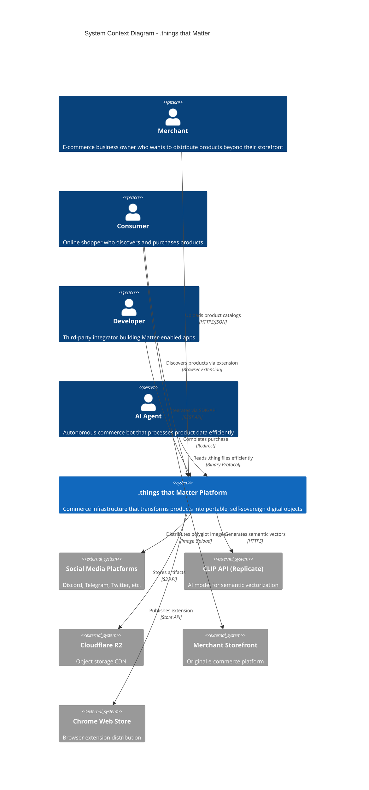

**Text Representation:**

```
┌─────────────────────────────────────────────────────────────────────────────┐
│                              EXTERNAL ACTORS                                 │
├─────────────────────────────────────────────────────────────────────────────┤
│                                                                              │
│   👤 Merchant        👤 Consumer        🤖 AI Agent        👨‍💻 Developer      │
│   (Product Owner)    (Shopper)          (Bot)              (Integrator)      │
│        │                 │                  │                   │            │
│        │ Upload          │ Discover         │ Parse             │ Integrate  │
│        │ Catalog         │ Products         │ .thing            │ SDK        │
│        ▼                 ▼                  ▼                   ▼            │
│   ┌─────────────────────────────────────────────────────────────────────┐   │
│   │                                                                      │   │
│   │                  .things that Matter Platform                        │   │
│   │                                                                      │   │
│   │   "Commerce infrastructure for portable, self-sovereign products"   │   │
│   │                                                                      │   │
│   └─────────────────────────────────────────────────────────────────────┘   │
│        │                 │                  │                   │            │
│        ▼                 ▼                  ▼                   ▼            │
│   ┌─────────┐      ┌──────────┐      ┌───────────┐      ┌────────────┐      │
│   │ CLIP    │      │Cloudflare│      │  Social   │      │  Chrome    │      │
│   │ API     │      │   R2     │      │  Media    │      │Web Store   │      │
│   │(Replicate)│    │  (CDN)   │      │ Platforms │      │            │      │
│   └─────────┘      └──────────┘      └───────────┘      └────────────┘      │
│                                                                              │
└─────────────────────────────────────────────────────────────────────────────┘
```

---

### 1.2 Container Diagram (Level 2)

Shows the high-level technical building blocks.

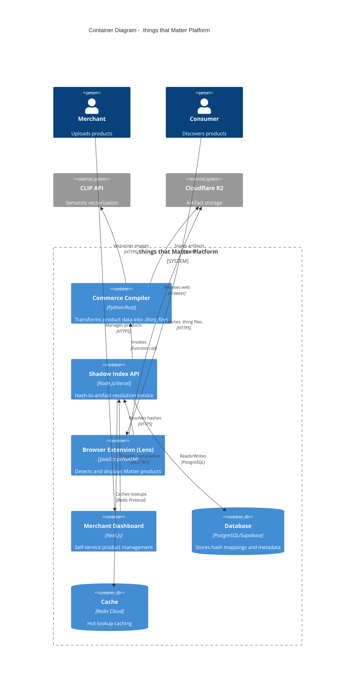

**Text Representation:**

```
┌─────────────────────────────────────────────────────────────────────────────┐
│                    .things that Matter Platform                              │
├─────────────────────────────────────────────────────────────────────────────┤
│                                                                              │
│  ┌──────────────────┐        ┌──────────────────┐        ┌───────────────┐  │
│  │                  │        │                  │        │               │  │
│  │    Merchant      │───────▶│   Shadow Index   │◀───────│   Browser     │  │
│  │    Dashboard     │  API   │      API         │  API   │   Extension   │  │
│  │   (Next.js)      │        │ (Node.js/Vercel) │        │    (Lens)     │  │
│  │                  │        │                  │        │               │  │
│  └──────────────────┘        └────────┬─────────┘        └───────────────┘  │
│                                       │                                      │
│                                       ▼                                      │
│                              ┌──────────────────┐                            │
│                              │                  │                            │
│                              │    Commerce      │                            │
│                              │    Compiler      │                            │
│                              │  (Python/Rust)   │                            │
│                              │                  │                            │
│                              └────────┬─────────┘                            │
│                                       │                                      │
│           ┌───────────────────────────┼───────────────────────────┐          │
│           ▼                           ▼                           ▼          │
│  ┌──────────────────┐        ┌──────────────────┐        ┌───────────────┐  │
│  │    Supabase      │        │   Redis Cloud    │        │ Cloudflare R2 │  │
│  │   (PostgreSQL)   │        │    (Cache)       │        │    (CDN)      │  │
│  └──────────────────┘        └──────────────────┘        └───────────────┘  │
│                                                                              │
└─────────────────────────────────────────────────────────────────────────────┘
                                       │
                                       ▼
                              ┌──────────────────┐
                              │    CLIP API      │
                              │   (Replicate)    │
                              └──────────────────┘
```

---

## 2. Use Case Diagrams

### 2.1 Merchant Use Cases

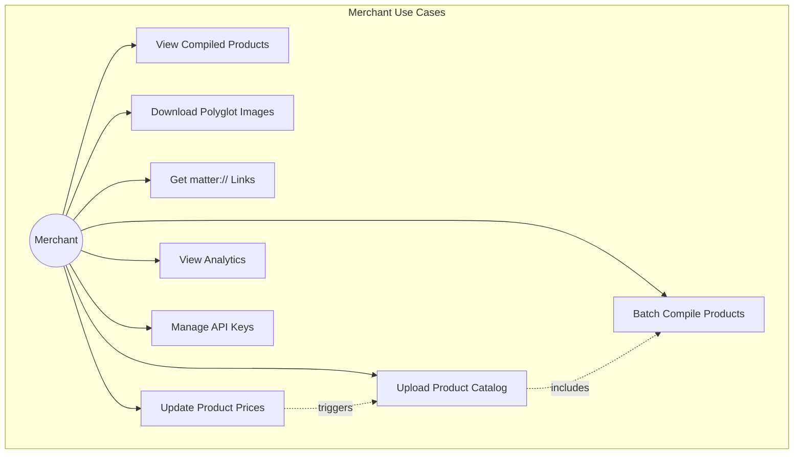

**Text Representation:**

```
                         ┌─────────────────────────────────────┐
                         │        MERCHANT USE CASES           │
                         └─────────────────────────────────────┘
                                          │
                                     ┌────┴────┐
                                     │Merchant │
                                     │   👤    │
                                     └────┬────┘
                                          │
         ┌────────────────────────────────┼────────────────────────────────┐
         │                │               │               │                │
         ▼                ▼               ▼               ▼                ▼
    ┌─────────┐     ┌─────────┐     ┌─────────┐    ┌─────────┐      ┌─────────┐
    │ Upload  │     │  View   │     │Download │    │  Get    │      │ Update  │
    │ Product │     │Compiled │     │Polyglot │    │matter://│      │ Product │
    │ Catalog │     │Products │     │ Images  │    │  Links  │      │ Prices  │
    └─────────┘     └─────────┘     └─────────┘    └─────────┘      └─────────┘
         │
         │ «includes»
         ▼
    ┌─────────┐
    │  Batch  │
    │ Compile │
    │Products │
    └─────────┘
```

---

### 2.2 Consumer Use Cases

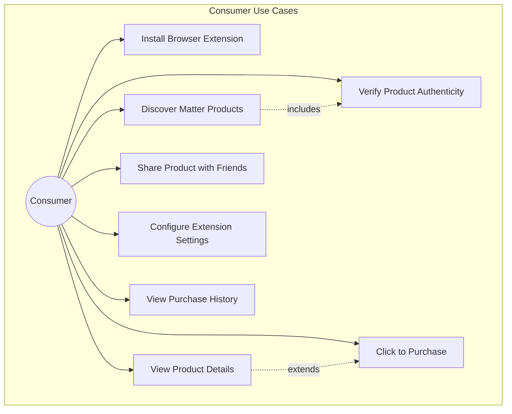

**Text Representation:**

```
                         ┌─────────────────────────────────────┐
                         │        CONSUMER USE CASES           │
                         └─────────────────────────────────────┘
                                          │
                                     ┌────┴────┐
                                     │Consumer │
                                     │   👤    │
                                     └────┬────┘
                                          │
    ┌─────────────────────────────────────┼─────────────────────────────────────┐
    │           │           │             │             │           │           │
    ▼           ▼           ▼             ▼             ▼           ▼           ▼
┌───────┐ ┌─────────┐ ┌─────────┐   ┌─────────┐   ┌─────────┐ ┌─────────┐ ┌─────────┐
│Install│ │Discover │ │  View   │   │ Verify  │   │Click to │ │  Share  │ │Configure│
│Browser│ │ Matter  │ │ Product │   │Authentic│   │Purchase │ │ Product │ │Settings │
│Extensn│ │Products │ │ Details │   │  -ity   │   │         │ │         │ │         │
└───────┘ └────┬────┘ └────┬────┘   └─────────┘   └─────────┘ └─────────┘ └─────────┘
               │           │              ▲
               │«includes» │ «extends»    │
               └───────────┴──────────────┘
```

---

### 2.3 Developer Use Cases

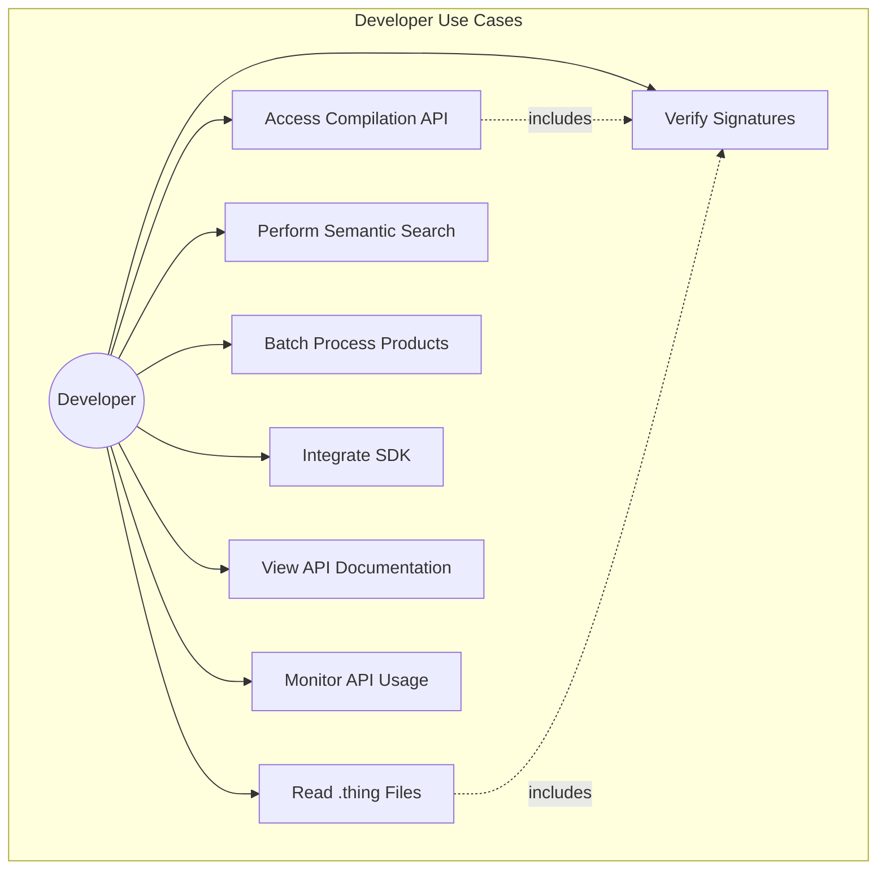

---

### 2.4 AI Agent Use Cases

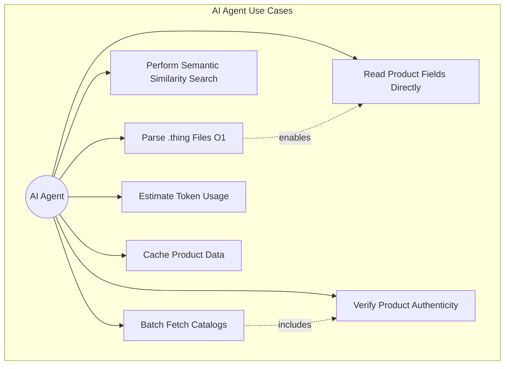

---

## 3. Class Diagrams

### 3.1 Domain Model - Core Entities

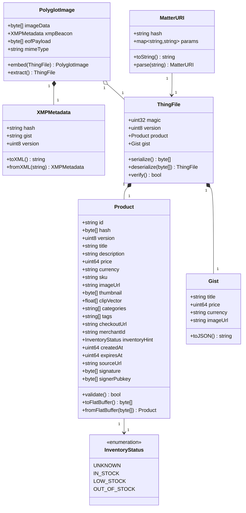

**Text Representation:**

```
┌─────────────────────────────────────────────────────────────────────────────┐
│                           DOMAIN MODEL                                       │
└─────────────────────────────────────────────────────────────────────────────┘

┌──────────────────────────┐         ┌──────────────────────────┐
│       ThingFile          │         │     PolyglotImage        │
├──────────────────────────┤         ├──────────────────────────┤
│ +magic: uint32           │         │ +imageData: byte[]       │
│ +version: uint8          │         │ +xmpBeacon: XMPMetadata  │
│ +product: Product        │◆────────│ +eofPayload: byte[]      │
│ +gist: Gist              │         │ +mimeType: string        │
├──────────────────────────┤         ├──────────────────────────┤
│ +serialize(): byte[]     │         │ +embed(): PolyglotImage  │
│ +deserialize(): ThingFile│         │ +extract(): ThingFile    │
│ +verify(): bool          │         └──────────────────────────┘
└──────────┬───────────────┘                     │
           │                                     │
           ▼                                     ▼
┌──────────────────────────┐         ┌──────────────────────────┐
│        Product           │         │      XMPMetadata         │
├──────────────────────────┤         ├──────────────────────────┤
│ +id: string              │         │ +hash: string            │
│ +hash: byte[]            │         │ +gist: string            │
│ +title: string           │         │ +version: uint8          │
│ +description: string     │         ├──────────────────────────┤
│ +price: uint64           │         │ +toXML(): string         │
│ +currency: string        │         │ +fromXML(): XMPMetadata  │
│ +clipVector: float[512]  │         └──────────────────────────┘
│ +checkoutUrl: string     │
│ +signature: byte[]       │         ┌──────────────────────────┐
│ +signerPubkey: byte[]    │         │       MatterURI          │
├──────────────────────────┤         ├──────────────────────────┤
│ +validate(): bool        │         │ +hash: string            │
│ +toFlatBuffer(): byte[]  │         │ +params: map             │
└──────────────────────────┘         ├──────────────────────────┤
           │                         │ +toString(): string      │
           ▼                         │ +parse(): MatterURI      │
┌──────────────────────────┐         └──────────────────────────┘
│   <<enumeration>>        │
│   InventoryStatus        │         ┌──────────────────────────┐
├──────────────────────────┤         │         Gist             │
│ UNKNOWN                  │         ├──────────────────────────┤
│ IN_STOCK                 │         │ +title: string           │
│ LOW_STOCK                │         │ +price: uint64           │
│ OUT_OF_STOCK             │         │ +currency: string        │
└──────────────────────────┘         │ +imageUrl: string        │
                                     ├──────────────────────────┤
                                     │ +toJSON(): string        │
                                     └──────────────────────────┘
```

---

### 3.2 Commerce Compiler Architecture

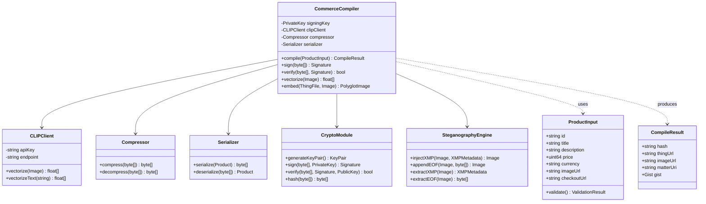

---

### 3.3 Browser Extension Architecture

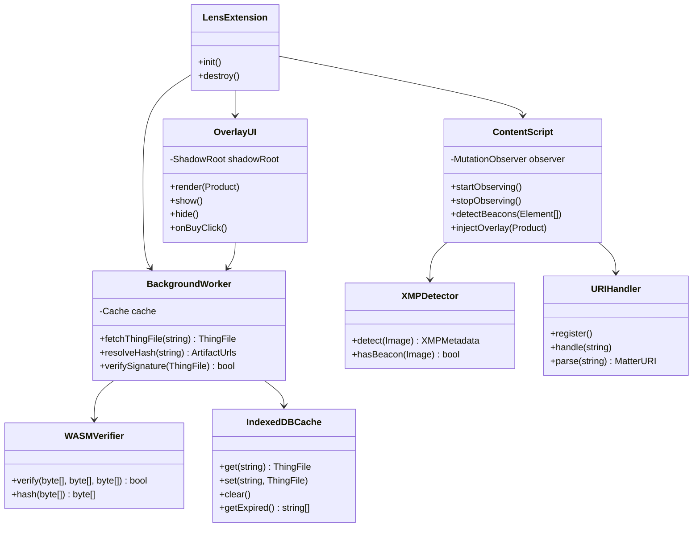

---

## 4. Sequence Diagrams

### 4.1 Product Compilation Flow

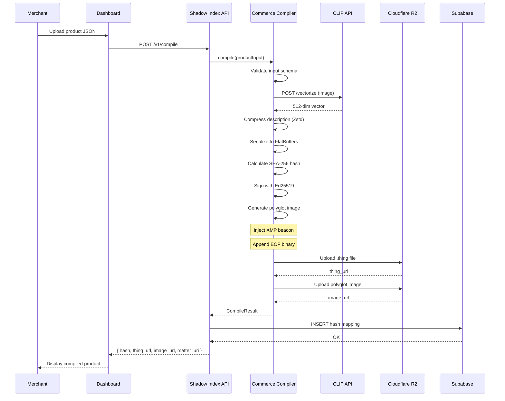

**Text Representation:**

```
Merchant    Dashboard    Shadow Index    Compiler    CLIP API    R2 CDN    Database
   │            │           API             │           │          │          │
   │ Upload     │            │              │           │          │          │
   │ Product    │            │              │           │          │          │
   │───────────▶│            │              │           │          │          │
   │            │ POST       │              │           │          │          │
   │            │ /compile   │              │           │          │          │
   │            │───────────▶│              │           │          │          │
   │            │            │ compile()    │           │          │          │
   │            │            │─────────────▶│           │          │          │
   │            │            │              │           │          │          │
   │            │            │              │ Validate  │          │          │
   │            │            │              │ Input     │          │          │
   │            │            │              │           │          │          │
   │            │            │              │ POST      │          │          │
   │            │            │              │ /vectorize│          │          │
   │            │            │              │──────────▶│          │          │
   │            │            │              │           │          │          │
   │            │            │              │ 512-dim   │          │          │
   │            │            │              │◀──────────│          │          │
   │            │            │              │           │          │          │
   │            │            │              │ Compress, │          │          │
   │            │            │              │ Serialize,│          │          │
   │            │            │              │ Hash,     │          │          │
   │            │            │              │ Sign      │          │          │
   │            │            │              │           │          │          │
   │            │            │              │ Generate  │          │          │
   │            │            │              │ Polyglot  │          │          │
   │            │            │              │           │          │          │
   │            │            │              │ Upload    │          │          │
   │            │            │              │ .thing    │          │          │
   │            │            │              │──────────────────────▶│          │
   │            │            │              │◀──────────────────────│          │
   │            │            │              │           │          │          │
   │            │            │              │ Upload    │          │          │
   │            │            │              │ image     │          │          │
   │            │            │              │──────────────────────▶│          │
   │            │            │              │◀──────────────────────│          │
   │            │            │              │           │          │          │
   │            │            │◀─────────────│           │          │          │
   │            │            │              │           │          │          │
   │            │            │ INSERT       │           │          │          │
   │            │            │──────────────────────────────────────────────▶│
   │            │            │◀──────────────────────────────────────────────│
   │            │            │              │           │          │          │
   │            │◀───────────│              │           │          │          │
   │◀───────────│            │              │           │          │          │
   │            │            │              │           │          │          │
```

---

### 4.2 Product Discovery Flow (Consumer)

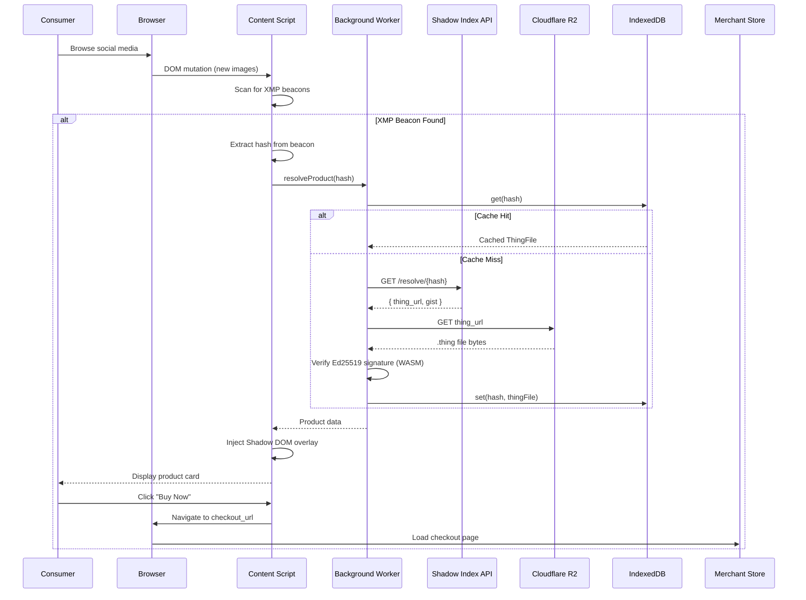

**Text Representation:**

```
Consumer     Browser     Content      Background    Shadow       R2        IndexedDB    Merchant
                         Script       Worker        Index API    CDN       Cache        Store
   │           │           │             │             │          │           │            │
   │ Browse    │           │             │             │          │           │            │
   │ Page      │           │             │             │          │           │            │
   │──────────▶│           │             │             │          │           │            │
   │           │ DOM       │             │             │          │           │            │
   │           │ Mutation  │             │             │          │           │            │
   │           │──────────▶│             │             │          │           │            │
   │           │           │             │             │          │           │            │
   │           │           │ Scan for    │             │          │           │            │
   │           │           │ XMP Beacons │             │          │           │            │
   │           │           │             │             │          │           │            │
   │           │           │ Extract     │             │          │           │            │
   │           │           │ Hash        │             │          │           │            │
   │           │           │             │             │          │           │            │
   │           │           │ resolve     │             │          │           │            │
   │           │           │ Product     │             │          │           │            │
   │           │           │────────────▶│             │          │           │            │
   │           │           │             │             │          │           │            │
   │           │           │             │ Check Cache │          │           │            │
   │           │           │             │────────────────────────────────────▶│            │
   │           │           │             │             │          │           │            │
   │           │           │             │ [Cache Miss]│          │           │            │
   │           │           │             │ GET /resolve│          │           │            │
   │           │           │             │────────────▶│          │           │            │
   │           │           │             │◀────────────│          │           │            │
   │           │           │             │             │          │           │            │
   │           │           │             │ GET .thing  │          │           │            │
   │           │           │             │─────────────────────────▶│          │            │
   │           │           │             │◀─────────────────────────│          │            │
   │           │           │             │             │          │           │            │
   │           │           │             │ Verify      │          │           │            │
   │           │           │             │ Signature   │          │           │            │
   │           │           │             │ (WASM)      │          │           │            │
   │           │           │             │             │          │           │            │
   │           │           │             │ Cache       │          │           │            │
   │           │           │             │────────────────────────────────────▶│            │
   │           │           │             │             │          │           │            │
   │           │           │◀────────────│             │          │           │            │
   │           │           │             │             │          │           │            │
   │           │           │ Inject      │             │          │           │            │
   │           │           │ Overlay     │             │          │           │            │
   │           │           │             │             │          │           │            │
   │◀──────────────────────│             │             │          │           │            │
   │           │           │             │             │          │           │            │
   │ Click     │           │             │             │          │           │            │
   │ Buy Now   │           │             │             │          │           │            │
   │──────────────────────▶│             │             │          │           │            │
   │           │           │             │             │          │           │            │
   │           │ Navigate  │             │             │          │           │            │
   │           │───────────────────────────────────────────────────────────────────────────▶│
   │           │           │             │             │          │           │            │
```

---

### 4.3 AI Agent Efficient Read Flow

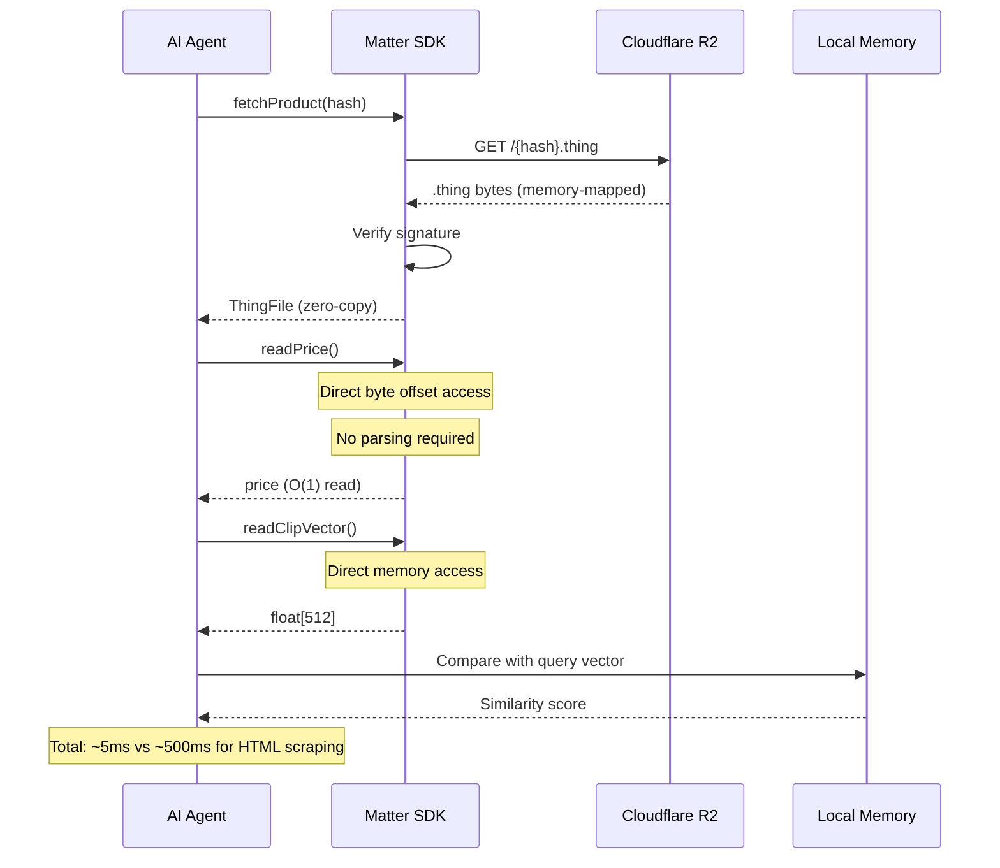

---

### 4.4 Batch Compilation Flow

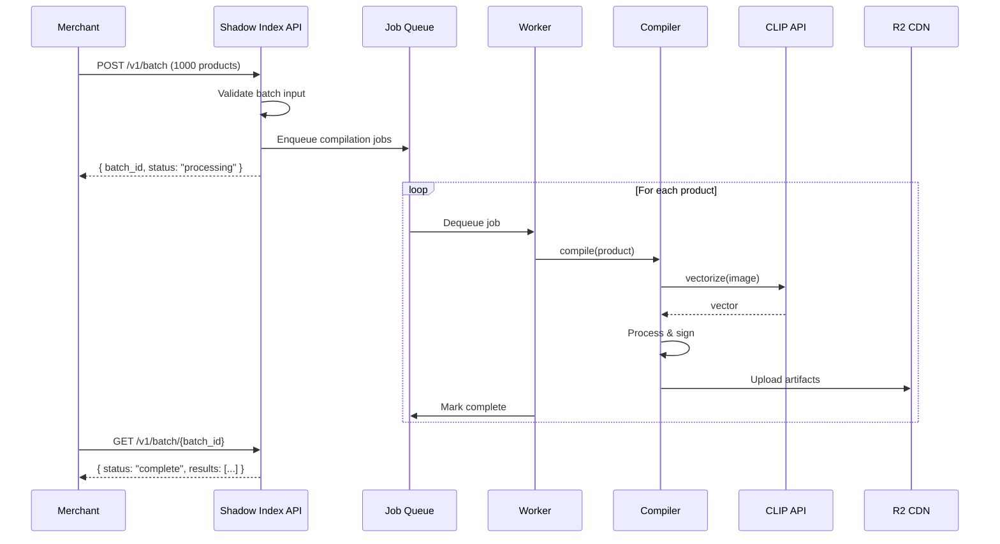

---

## 5. Activity Diagrams

### 5.1 Product Compilation Pipeline

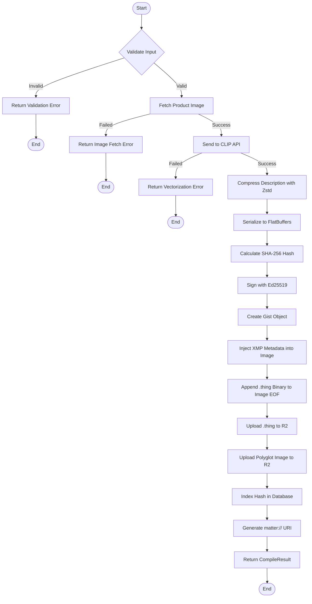

**Text Representation:**

```
                                    ┌─────────┐
                                    │  Start  │
                                    └────┬────┘
                                         │
                                         ▼
                               ┌─────────────────────┐
                               │   Validate Input    │
                               └─────────┬───────────┘
                                         │
                            ┌────────────┴────────────┐
                            │                         │
                       [Invalid]                  [Valid]
                            │                         │
                            ▼                         ▼
                   ┌────────────────┐      ┌─────────────────────┐
                   │ Return Error   │      │ Fetch Product Image │
                   └────────────────┘      └─────────┬───────────┘
                                                     │
                                        ┌────────────┴────────────┐
                                        │                         │
                                   [Failed]                  [Success]
                                        │                         │
                                        ▼                         ▼
                               ┌────────────────┐      ┌─────────────────────┐
                               │ Return Error   │      │ Send to CLIP API    │
                               └────────────────┘      └─────────┬───────────┘
                                                                 │
                                                                 ▼
                                                      ┌─────────────────────┐
                                                      │ Compress with Zstd  │
                                                      └─────────┬───────────┘
                                                                 │
                                                                 ▼
                                                      ┌─────────────────────┐
                                                      │ Serialize FlatBuffer│
                                                      └─────────┬───────────┘
                                                                 │
                                                                 ▼
                                                      ┌─────────────────────┐
                                                      │ Calculate SHA-256   │
                                                      └─────────┬───────────┘
                                                                 │
                                                                 ▼
                                                      ┌─────────────────────┐
                                                      │ Sign with Ed25519   │
                                                      └─────────┬───────────┘
                                                                 │
                                                                 ▼
                                                      ┌─────────────────────┐
                                                      │ Create Polyglot IMG │
                                                      │ (XMP + EOF Append)  │
                                                      └─────────┬───────────┘
                                                                 │
                                                                 ▼
                                                      ┌─────────────────────┐
                                                      │ Upload to R2 CDN    │
                                                      └─────────┬───────────┘
                                                                 │
                                                                 ▼
                                                      ┌─────────────────────┐
                                                      │ Index in Database   │
                                                      └─────────┬───────────┘
                                                                 │
                                                                 ▼
                                                      ┌─────────────────────┐
                                                      │ Return CompileResult│
                                                      └─────────┬───────────┘
                                                                 │
                                                                 ▼
                                                           ┌─────────┐
                                                           │   End   │
                                                           └─────────┘
```

---

### 5.2 Product Discovery Activity

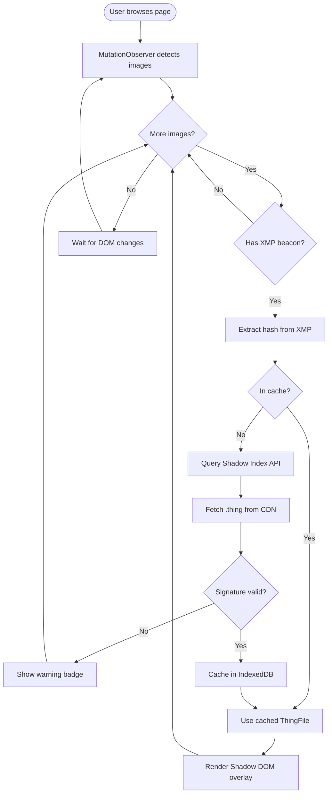

---

## 6. State Machine Diagrams

### 6.1 ThingFile Lifecycle States

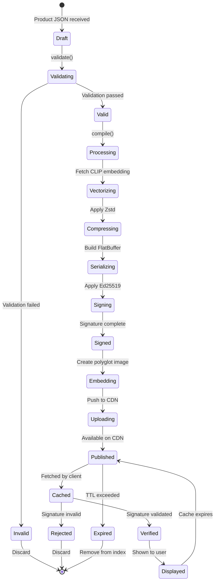

**Text Representation:**

```
                                    ┌─────────┐
                                    │ (Start) │
                                    └────┬────┘
                                         │ Product JSON received
                                         ▼
                                    ┌─────────┐
                                    │  Draft  │
                                    └────┬────┘
                                         │ validate()
                                         ▼
                                  ┌─────────────┐
                                  │ Validating  │
                                  └──────┬──────┘
                           ┌─────────────┴─────────────┐
                      [Failed]                    [Passed]
                           │                           │
                           ▼                           ▼
                      ┌─────────┐               ┌─────────┐
                      │ Invalid │               │  Valid  │
                      └────┬────┘               └────┬────┘
                           │                        │ compile()
                           ▼                        ▼
                      ┌─────────┐         ┌────────────────┐
                      │ (End)   │         │  Processing    │
                      └─────────┘         └───────┬────────┘
                                                  │
                                    ┌─────────────┼─────────────┐
                                    ▼             ▼             ▼
                              ┌──────────┐ ┌───────────┐ ┌──────────┐
                              │Vectorize │→│ Compress  │→│Serialize │
                              └──────────┘ └───────────┘ └────┬─────┘
                                                              │
                                                              ▼
                                                        ┌──────────┐
                                                        │ Signing  │
                                                        └────┬─────┘
                                                             │
                                                             ▼
                                                        ┌──────────┐
                                                        │  Signed  │
                                                        └────┬─────┘
                                                             │ Create polyglot
                                                             ▼
                                                        ┌──────────┐
                                                        │Embedding │
                                                        └────┬─────┘
                                                             │ Upload to CDN
                                                             ▼
                                                        ┌──────────┐
                                                        │Uploading │
                                                        └────┬─────┘
                                                             │
                                                             ▼
                                                        ┌──────────┐
                              TTL exceeded              │Published │
                           ┌───────────────────────────│          │
                           │                           └────┬─────┘
                           ▼                                │ Fetched by client
                      ┌─────────┐                           ▼
                      │ Expired │                      ┌──────────┐
                      └────┬────┘                      │  Cached  │
                           │                           └────┬─────┘
                           ▼                    ┌───────────┴───────────┐
                      ┌─────────┐          [Valid]                 [Invalid]
                      │ (End)   │               │                       │
                      └─────────┘               ▼                       ▼
                                          ┌──────────┐            ┌──────────┐
                                          │ Verified │            │ Rejected │
                                          └────┬─────┘            └────┬─────┘
                                               │                       │
                                               ▼                       ▼
                                          ┌──────────┐            ┌─────────┐
                                          │Displayed │            │ (End)   │
                                          └──────────┘            └─────────┘
```

---

### 6.2 Browser Extension States

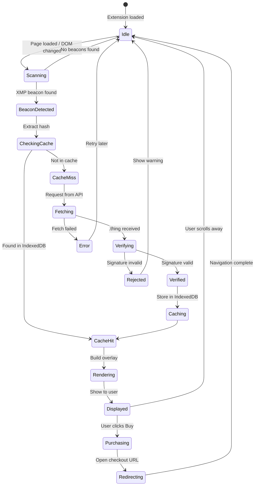

---

## 7. Data Flow Diagrams

### 7.1 Level 0 - Context Diagram

```
┌─────────────────────────────────────────────────────────────────────────────┐
│                           DATA FLOW DIAGRAM - LEVEL 0                        │
└─────────────────────────────────────────────────────────────────────────────┘

    ┌──────────────┐                                      ┌──────────────┐
    │              │      Product Catalog (JSON)          │              │
    │   Merchant   │─────────────────────────────────────▶│              │
    │              │                                      │              │
    │              │◀─────────────────────────────────────│              │
    │              │   Compiled Assets (URLs, URIs)       │              │
    └──────────────┘                                      │              │
                                                          │   .things    │
    ┌──────────────┐                                      │     that     │
    │              │      Discover Product (Hash)         │    Matter    │
    │   Consumer   │─────────────────────────────────────▶│   Platform   │
    │              │                                      │              │
    │              │◀─────────────────────────────────────│              │
    │              │   Product Data (.thing)              │              │
    └──────────────┘                                      │              │
                                                          │              │
    ┌──────────────┐                                      │              │
    │              │      API Request (Hash/Batch)        │              │
    │  AI Agent    │─────────────────────────────────────▶│              │
    │              │                                      │              │
    │              │◀─────────────────────────────────────│              │
    │              │   Binary .thing Data                 │              │
    └──────────────┘                                      │              │
                                                          │              │
    ┌──────────────┐                                      │              │
    │              │      SDK/API Integration             │              │
    │  Developer   │─────────────────────────────────────▶│              │
    │              │                                      │              │
    │              │◀─────────────────────────────────────│              │
    │              │   Documentation, Libraries           └──────────────┘
    └──────────────┘
```

---

### 7.2 Level 1 - System Processes

```
┌─────────────────────────────────────────────────────────────────────────────┐
│                           DATA FLOW DIAGRAM - LEVEL 1                        │
└─────────────────────────────────────────────────────────────────────────────┘

                              Product JSON
    ┌──────────┐         ┌────────────────────┐         ┌──────────────┐
    │          │────────▶│                    │────────▶│              │
    │ Merchant │         │   1.0 COMPILE      │         │   D1: R2     │
    │          │◀────────│     PRODUCT        │◀────────│   Storage    │
    │          │ URLs    │                    │ URLs    │              │
    └──────────┘         └─────────┬──────────┘         └──────────────┘
                                   │
                                   │ Hash + Metadata
                                   ▼
                         ┌────────────────────┐         ┌──────────────┐
                         │                    │────────▶│              │
                         │   2.0 INDEX        │         │ D2: Database │
                         │     PRODUCT        │◀────────│  (Supabase)  │
                         │                    │         │              │
                         └─────────┬──────────┘         └──────────────┘
                                   │
                                   │ Indexed Hash
                                   ▼
    ┌──────────┐         ┌────────────────────┐
    │          │ Hash    │                    │
    │ Consumer │────────▶│   3.0 RESOLVE      │
    │          │◀────────│     PRODUCT        │
    │          │ .thing  │                    │
    └──────────┘         └─────────┬──────────┘
                                   │
                                   │ .thing bytes
                                   ▼
                         ┌────────────────────┐
                         │                    │
                         │   4.0 VERIFY       │
                         │    SIGNATURE       │
                         │                    │
                         └─────────┬──────────┘
                                   │
                                   │ Verified Product
                                   ▼
                         ┌────────────────────┐
                         │                    │
                         │   5.0 DISPLAY      │
                         │    OVERLAY         │
                         │                    │
                         └────────────────────┘
```

---

### 7.3 Level 2 - Compilation Process Detail

```
┌─────────────────────────────────────────────────────────────────────────────┐
│                           DATA FLOW DIAGRAM - LEVEL 2                        │
│                           (Compilation Process)                              │
└─────────────────────────────────────────────────────────────────────────────┘

                              Product JSON
                                   │
                                   ▼
                         ┌────────────────────┐
                         │  1.1 VALIDATE      │
                         │      INPUT         │
                         └─────────┬──────────┘
                                   │ Valid Product
                                   ▼
    ┌──────────┐         ┌────────────────────┐
    │ External │◀────────│  1.2 FETCH         │
    │ Image    │────────▶│      IMAGE         │
    │ Server   │ Image   │                    │
    └──────────┘         └─────────┬──────────┘
                                   │ Image Bytes
                                   ▼
    ┌──────────┐         ┌────────────────────┐
    │ CLIP API │◀────────│  1.3 VECTORIZE     │
    │(Replicate)│────────▶│      IMAGE         │
    │          │ Vector  │                    │
    └──────────┘         └─────────┬──────────┘
                                   │ 512-dim Vector
                                   ▼
                         ┌────────────────────┐
                         │  1.4 COMPRESS      │
                         │   DESCRIPTION      │
                         └─────────┬──────────┘
                                   │ Compressed Bytes
                                   ▼
                         ┌────────────────────┐
                         │  1.5 SERIALIZE     │
                         │   FLATBUFFERS      │
                         └─────────┬──────────┘
                                   │ Binary Buffer
                                   ▼
                         ┌────────────────────┐
                         │  1.6 CALCULATE     │
                         │      HASH          │
                         └─────────┬──────────┘
                                   │ SHA-256 Hash
                                   ▼
    ┌──────────┐         ┌────────────────────┐
    │ D3: Key  │────────▶│  1.7 SIGN          │
    │  Store   │ Priv Key│   ED25519          │
    └──────────┘         └─────────┬──────────┘
                                   │ Signed .thing
                                   ▼
                         ┌────────────────────┐
                         │  1.8 EMBED         │
                         │   STEGANOGRAPHY    │
                         └─────────┬──────────┘
                                   │ Polyglot Image
                                   ▼
    ┌──────────┐         ┌────────────────────┐
    │ D1: R2   │◀────────│  1.9 UPLOAD        │
    │ Storage  │────────▶│   ARTIFACTS        │
    └──────────┘ URLs    │                    │
                         └────────────────────┘
```

---

## 8. Entity Relationship Diagram

### 8.1 Database Schema ERD

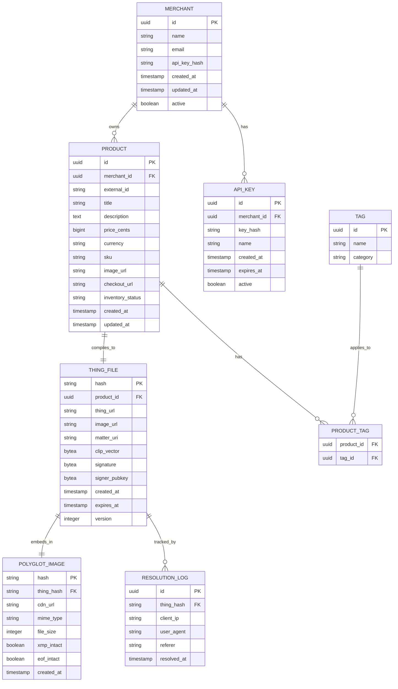

**Text Representation:**

```
┌─────────────────────────────────────────────────────────────────────────────┐
│                      ENTITY RELATIONSHIP DIAGRAM                             │
└─────────────────────────────────────────────────────────────────────────────┘

┌─────────────────────┐         ┌─────────────────────┐
│      MERCHANT       │         │       API_KEY       │
├─────────────────────┤         ├─────────────────────┤
│ PK id: uuid         │───┐     │ PK id: uuid         │
│    name: string     │   │     │ FK merchant_id: uuid│◀──┐
│    email: string    │   │     │    key_hash: string │   │
│    api_key_hash     │   │     │    name: string     │   │
│    created_at       │   │     │    created_at       │   │
│    updated_at       │   │     │    expires_at       │   │
│    active: boolean  │   │     │    active: boolean  │   │
└─────────────────────┘   │     └─────────────────────┘   │
          │               │                               │
          │ owns          └───────────────────────────────┘
          │
          ▼
┌─────────────────────┐         ┌─────────────────────┐
│       PRODUCT       │         │     THING_FILE      │
├─────────────────────┤         ├─────────────────────┤
│ PK id: uuid         │────────▶│ PK hash: string     │
│ FK merchant_id: uuid│         │ FK product_id: uuid │
│    external_id      │         │    thing_url        │
│    title: string    │         │    image_url        │
│    description: text│         │    matter_uri       │
│    price_cents      │         │    clip_vector      │
│    currency         │         │    signature        │
│    sku              │         │    signer_pubkey    │
│    image_url        │         │    created_at       │
│    checkout_url     │         │    expires_at       │
│    inventory_status │         │    version          │
│    created_at       │         └─────────────────────┘
│    updated_at       │                   │
└─────────────────────┘                   │ embeds_in
          │                               ▼
          │ has              ┌─────────────────────┐
          ▼                  │   POLYGLOT_IMAGE    │
┌─────────────────────┐      ├─────────────────────┤
│    PRODUCT_TAG      │      │ PK hash: string     │
├─────────────────────┤      │ FK thing_hash       │
│ FK product_id: uuid │      │    cdn_url          │
│ FK tag_id: uuid     │      │    mime_type        │
└─────────────────────┘      │    file_size        │
          │                  │    xmp_intact       │
          │                  │    eof_intact       │
          ▼                  │    created_at       │
┌─────────────────────┐      └─────────────────────┘
│        TAG          │
├─────────────────────┤      ┌─────────────────────┐
│ PK id: uuid         │      │   RESOLUTION_LOG    │
│    name: string     │      ├─────────────────────┤
│    category: string │      │ PK id: uuid         │
└─────────────────────┘      │ FK thing_hash       │
                             │    client_ip        │
                             │    user_agent       │
                             │    referer          │
                             │    resolved_at      │
                             └─────────────────────┘
```

---

## 9. Deployment Diagram

### 9.1 Production Infrastructure

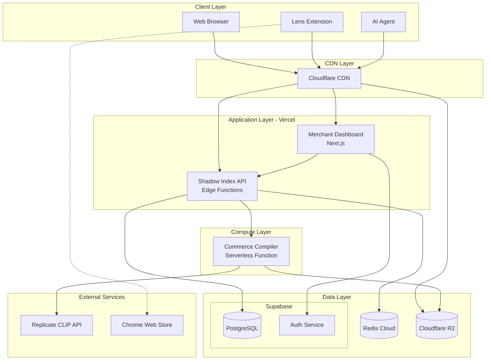

**Text Representation:**

```
┌─────────────────────────────────────────────────────────────────────────────┐
│                         DEPLOYMENT DIAGRAM                                   │
└─────────────────────────────────────────────────────────────────────────────┘

┌─────────────────────────────────────────────────────────────────────────────┐
│                              CLIENT LAYER                                    │
├─────────────────────────────────────────────────────────────────────────────┤
│                                                                              │
│   ┌─────────────┐      ┌─────────────┐      ┌─────────────┐                │
│   │ Web Browser │      │   Lens      │      │  AI Agent   │                │
│   │             │      │  Extension  │      │   (Bot)     │                │
│   └──────┬──────┘      └──────┬──────┘      └──────┬──────┘                │
│          │                    │                    │                        │
└──────────┼────────────────────┼────────────────────┼────────────────────────┘
           │                    │                    │
           └────────────────────┼────────────────────┘
                                │
                                ▼
┌─────────────────────────────────────────────────────────────────────────────┐
│                              CDN LAYER                                       │
├─────────────────────────────────────────────────────────────────────────────┤
│                       ┌─────────────────────┐                               │
│                       │   Cloudflare CDN    │                               │
│                       │   (Edge Network)    │                               │
│                       └──────────┬──────────┘                               │
└──────────────────────────────────┼──────────────────────────────────────────┘
                                   │
           ┌───────────────────────┼───────────────────────┐
           │                       │                       │
           ▼                       ▼                       ▼
┌─────────────────────────────────────────────────────────────────────────────┐
│                         APPLICATION LAYER (Vercel)                           │
├─────────────────────────────────────────────────────────────────────────────┤
│                                                                              │
│   ┌─────────────────────┐          ┌─────────────────────┐                  │
│   │  Merchant Dashboard │          │   Shadow Index API  │                  │
│   │     (Next.js)       │─────────▶│  (Edge Functions)   │                  │
│   │                     │          │                     │                  │
│   └─────────────────────┘          └──────────┬──────────┘                  │
│                                               │                              │
└───────────────────────────────────────────────┼──────────────────────────────┘
                                                │
                                                ▼
┌─────────────────────────────────────────────────────────────────────────────┐
│                            COMPUTE LAYER                                     │
├─────────────────────────────────────────────────────────────────────────────┤
│                       ┌─────────────────────┐                               │
│                       │  Commerce Compiler  │                               │
│                       │(Serverless Function)│                               │
│                       └──────────┬──────────┘                               │
└──────────────────────────────────┼──────────────────────────────────────────┘
                                   │
           ┌───────────────────────┼───────────────────────┐
           │                       │                       │
           ▼                       ▼                       ▼
┌─────────────────────────────────────────────────────────────────────────────┐
│                              DATA LAYER                                      │
├─────────────────────────────────────────────────────────────────────────────┤
│                                                                              │
│   ┌─────────────────┐  ┌─────────────────┐  ┌─────────────────┐            │
│   │    Supabase     │  │   Redis Cloud   │  │  Cloudflare R2  │            │
│   │   (PostgreSQL)  │  │    (Cache)      │  │   (Storage)     │            │
│   │                 │  │                 │  │                 │            │
│   │ • Hash mappings │  │ • Hot lookups   │  │ • .thing files  │            │
│   │ • Metadata      │  │ • Rate limits   │  │ • Polyglot imgs │            │
│   │ • Analytics     │  │                 │  │                 │            │
│   └─────────────────┘  └─────────────────┘  └─────────────────┘            │
│                                                                              │
└─────────────────────────────────────────────────────────────────────────────┘

┌─────────────────────────────────────────────────────────────────────────────┐
│                          EXTERNAL SERVICES                                   │
├─────────────────────────────────────────────────────────────────────────────┤
│                                                                              │
│   ┌─────────────────┐                      ┌─────────────────┐              │
│   │  Replicate API  │                      │ Chrome Web Store│              │
│   │  (CLIP Model)   │                      │  (Extension)    │              │
│   └─────────────────┘                      └─────────────────┘              │
│                                                                              │
└─────────────────────────────────────────────────────────────────────────────┘
```

---

## 10. Component Diagrams

### 10.1 Commerce Compiler Components

```mermaid
graph TB
    subgraph "Commerce Compiler (matter-core)"
        subgraph "Ingestion Layer"
            Validator[Input Validator<br/>Zod/Pydantic]
            ImageFetcher[Image Fetcher<br/>HTTP Client]
        end

        subgraph "Processing Layer"
            CLIPClient[CLIP Client<br/>Replicate API]
            Compressor[Compressor<br/>Zstd]
            Serializer[Serializer<br/>FlatBuffers]
            Hasher[Hasher<br/>SHA-256]
            Signer[Signer<br/>Ed25519]
        end

        subgraph "Emission Layer"
            StegEngine[Steganography Engine]
            XMPInjector[XMP Injector]
            EOFAppender[EOF Appender]
            URIGenerator[URI Generator<br/>matter://]
        end

        subgraph "Output Layer"
            Uploader[CDN Uploader<br/>R2 Client]
            Indexer[Index Writer<br/>DB Client]
        end
    end

    Validator --> ImageFetcher
    ImageFetcher --> CLIPClient
    CLIPClient --> Compressor
    Compressor --> Serializer
    Serializer --> Hasher
    Hasher --> Signer
    Signer --> StegEngine
    StegEngine --> XMPInjector
    XMPInjector --> EOFAppender
    EOFAppender --> URIGenerator
    URIGenerator --> Uploader
    Uploader --> Indexer
```

---

### 10.2 Browser Extension Components

```mermaid
graph TB
    subgraph "Browser Extension (Lens)"
        subgraph "Content Script"
            DOMObserver[DOM Observer<br/>MutationObserver]
            XMPDetector[XMP Detector<br/>Image Scanner]
            URIHandler[URI Handler<br/>matter:// Protocol]
            OverlayManager[Overlay Manager<br/>Shadow DOM]
        end

        subgraph "Background Worker"
            APIClient[API Client<br/>Fetch]
            WASMVerifier[WASM Verifier<br/>libmatter.wasm]
            CacheManager[Cache Manager<br/>IndexedDB]
            StateManager[State Manager]
        end

        subgraph "UI Components"
            ProductCard[Product Card]
            SettingsPage[Settings Page]
            WarningBadge[Warning Badge]
        end
    end

    DOMObserver --> XMPDetector
    XMPDetector --> StateManager
    URIHandler --> StateManager
    StateManager --> CacheManager
    StateManager --> APIClient
    APIClient --> WASMVerifier
    WASMVerifier --> CacheManager
    CacheManager --> OverlayManager
    OverlayManager --> ProductCard
    OverlayManager --> WarningBadge
```

---

### 10.3 Shadow Index API Components

```mermaid
graph TB
    subgraph "Shadow Index API"
        subgraph "API Routes"
            CompileRoute[POST /compile]
            BatchRoute[POST /batch]
            ResolveRoute[GET /resolve/:hash]
            GistRoute[GET /gist/:hash]
            HealthRoute[GET /health]
        end

        subgraph "Middleware"
            AuthMiddleware[Authentication<br/>API Key Validation]
            RateLimiter[Rate Limiter<br/>Token Bucket]
            Validator[Request Validator<br/>Zod Schema]
            ErrorHandler[Error Handler]
        end

        subgraph "Services"
            CompilerService[Compiler Service]
            ResolverService[Resolver Service]
            CacheService[Cache Service<br/>Redis]
            StorageService[Storage Service<br/>R2]
        end

        subgraph "Data Access"
            DBClient[Database Client<br/>Supabase]
            RedisClient[Redis Client]
            R2Client[R2 Client]
        end
    end

    CompileRoute --> AuthMiddleware
    BatchRoute --> AuthMiddleware
    ResolveRoute --> RateLimiter
    GistRoute --> RateLimiter

    AuthMiddleware --> Validator
    RateLimiter --> Validator
    Validator --> ErrorHandler

    ErrorHandler --> CompilerService
    ErrorHandler --> ResolverService

    CompilerService --> StorageService
    CompilerService --> DBClient
    ResolverService --> CacheService
    CacheService --> RedisClient
    StorageService --> R2Client
```

---

## 11. Appendix: Diagram Legend

### Symbol Reference

| Symbol | Meaning |
|--------|---------|
| ▢ | System/Container |
| ○ | Actor/User |
| ◇ | Decision Point |
| ═══ | Data Flow |
| ─── | Control Flow |
| ◆ | Composition |
| ◇ | Aggregation |
| ─▶ | Dependency |
| ─ ─▶ | Optional/Async |

### Color Coding (for rendered Mermaid)

| Color | Meaning |
|-------|---------|
| Blue | Core System Components |
| Green | External Services |
| Orange | Data Stores |
| Purple | User Interfaces |
| Red | Security Components |

---

## 12. Document Control

| Version | Date | Author | Changes |
|---------|------|--------|---------|
| 1.0 | Jan 21, 2026 | M. Mboweni | Initial comprehensive diagrams |

---

**Document Version:** 1.0  
**Last Updated:** January 21, 2026  
**Related Documents:** 01-PROJECT-CHARTER, 02-TECHNICAL-ARCHITECTURE, 03-PRD
