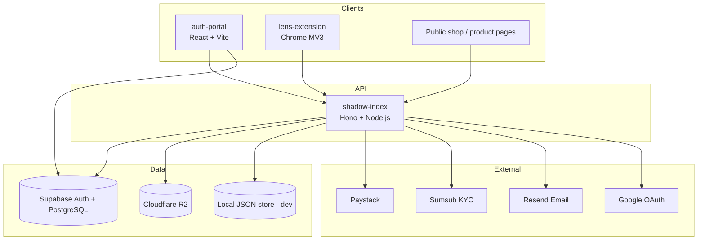
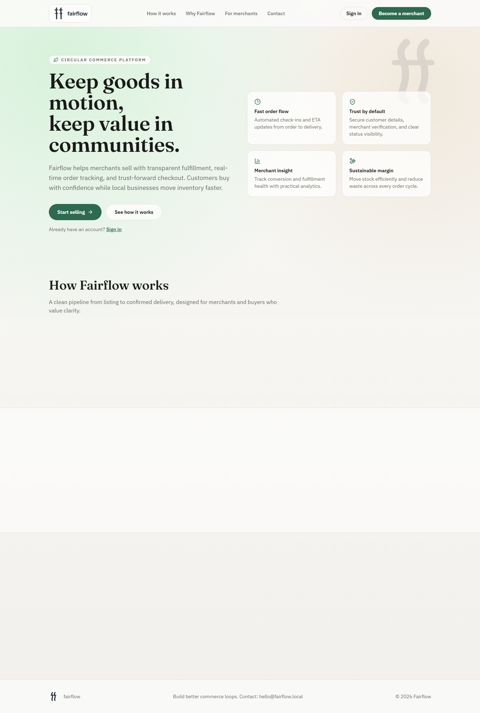
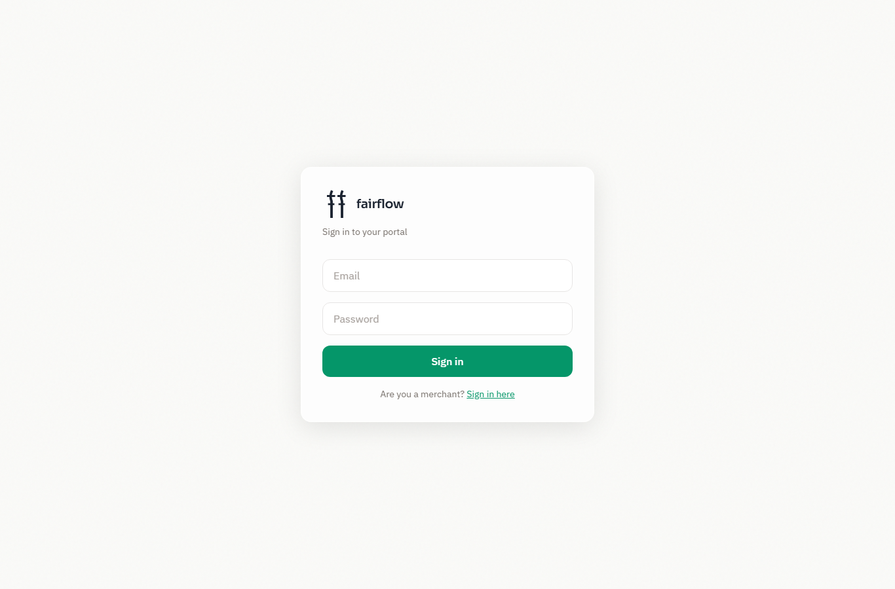
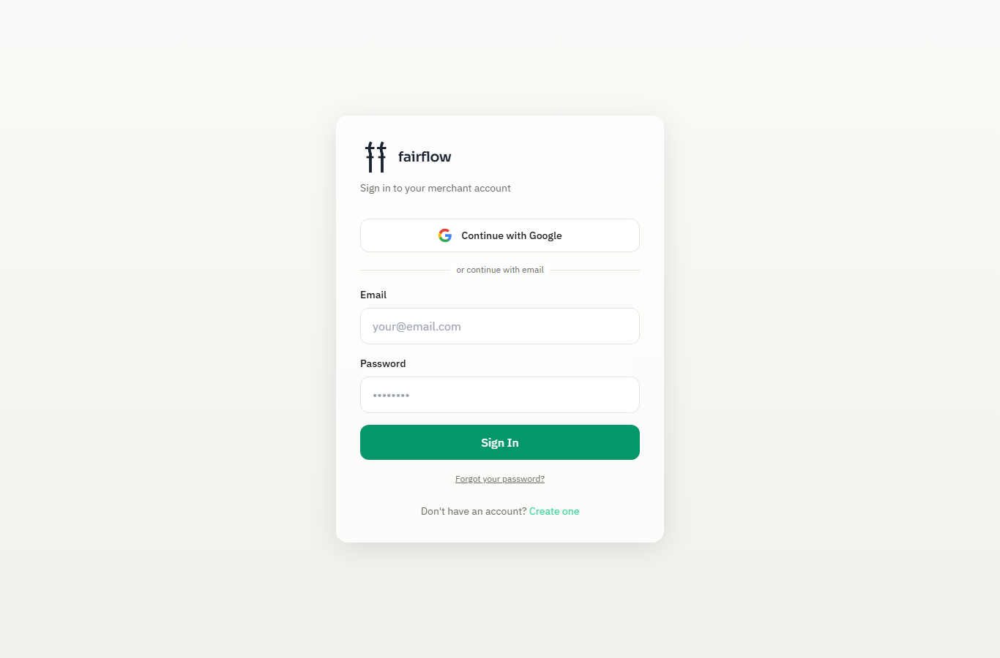
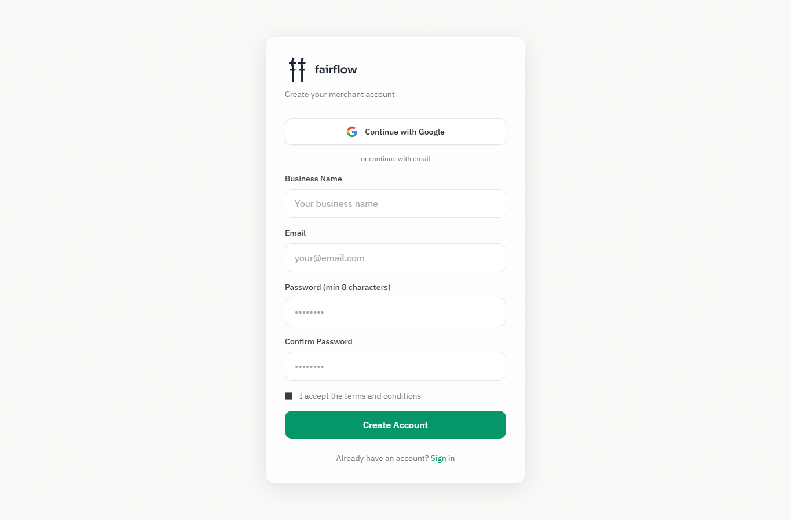
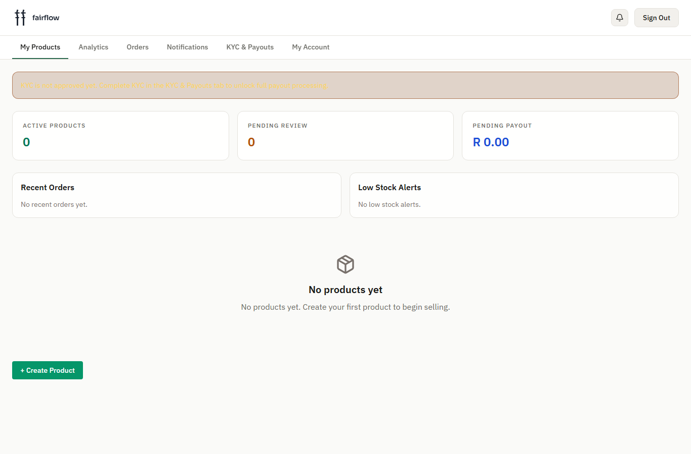

# Fairflow

[](https://github.com/MatomeMb/.Things-That-Matter/actions/workflows/ci.yml)
[](./LICENSE)
[](https://nodejs.org/)
[](https://www.typescriptlang.org/)

**Commerce infrastructure for South African merchants** — merchant operations, public checkout, portable product links, and admin controls in one monorepo.

> Production-minded open-source project. Built for real merchants, not demos alone.

---

## Problem statement

Independent merchants in South Africa often juggle fragmented tools: one stack for catalog, another for payments, another for KYC and payouts, and little portable identity for products shared outside a single storefront.

**Fairflow** unifies:

1. **Merchant operations** — onboarding, products, orders, notifications, KYC, payouts  
2. **Public commerce** — product pages and Paystack checkout  
3. **Portable product artifacts** — `matter://` identifiers and compiled `.thing` files  
4. **Platform admin** — KYC review, payout release, health monitoring  

---

## Features

| Area | Capabilities |
|------|----------------|
| **Merchant portal** | Register/login, Google OAuth, product CRUD, orders, analytics, KYC, payouts |
| **Consumer shop** | Public product pages, delivery details, Paystack payment |
| **Admin / CEO** | KYC queue, merchant oversight, payout release, platform health |
| **Shadow Index API** | Auth, catalog, checkout, webhooks, analytics, compile/resolve |
| **Matter compiler** | Rust pipeline for signed, content-addressed `.thing` artifacts |
| **Lens extension** | Browser extension to resolve product hashes on any page |

---

## Architecture



**Design decisions (why this stack):** see [docs/ARCHITECTURE.md](./docs/ARCHITECTURE.md) and [docs/adr/](./docs/adr/).

| Choice | Why |
|--------|-----|
| **Hono** | Small cold-start footprint on Vercel serverless; TypeScript-first middleware |
| **PostgreSQL + Supabase** | Managed auth + RLS for staff roles; familiar SQL for merchants/products |
| **Paystack** | Primary SA/Africa payment rails with reliable webhooks |
| **Local JSON / R2** | Fast local DX; S3-compatible object storage in production |
| **Custom merchant JWT** | Merchants are not forced through staff Supabase roles; clean separation |
| **Rust matter-core** | Deterministic compile, Ed25519 signing, content-addressed artifacts |

---

## Technology stack

| Layer | Technology |
|-------|------------|
| Frontend | React 19, TypeScript, Vite, Tailwind CSS |
| API | Node.js ≥ 18, Hono 4, Zod |
| Auth | Supabase Auth (staff), PBKDF2 + HS256 JWT (merchants), Google OAuth |
| Database | PostgreSQL (Supabase), file JSON (dev fallback) |
| Payments | Paystack (primary), Stripe hooks (legacy/optional) |
| KYC | Sumsub |
| Storage | Cloudflare R2 / local filesystem |
| Compiler | Rust (`matter-core`) |
| Tests | Vitest, Playwright |
| CI/CD | GitHub Actions, Vercel |

---

## Repository structure

```text
.
├── packages/
│   ├── auth-portal/       # React merchant / admin / shop SPA
│   ├── shadow-index/      # Hono commerce + resolution API
│   ├── matter-core/       # Rust .thing compiler
│   ├── matter-ffi/        # FFI bindings (experimental)
│   └── lens-extension/    # Chrome MV3 extension
├── supabase/
│   ├── migrations/        # SQL schema + RLS
│   └── functions/         # Edge hooks (custom access token)
├── docs/                  # Architecture, security, ops, ADRs
├── demo/                  # Static demo assets and snapshots
├── scripts/               # Dev, smoke, and validation helpers
├── tests/e2e/             # Playwright end-to-end tests
├── docker-compose.yml     # Local multi-service stack
└── .github/               # CI, templates, Dependabot, CODEOWNERS
```

| Path | Purpose |
|------|---------|
| `packages/auth-portal` | Role-based UI (merchant, admin/CEO, consumer shop) |
| `packages/shadow-index` | HTTP API: auth, products, checkout, webhooks, analytics |
| `packages/matter-core` | Compile product definitions into portable `.thing` binaries |
| `packages/lens-extension` | Resolve hashes and show product overlays in-browser |
| `supabase/` | Auth RBAC schema, products, KYC columns, edge functions |
| `docs/` | Canonical engineering documentation |
| `demo/` | Non-secret demo HTML/CSS and anonymized snapshots |
| `scripts/` | Setup checks, demo launchers, validation |

---

## System requirements

- **Node.js** 18+ (20 LTS recommended)
- **npm** 9+
- **Git** 2.30+
- **Rust** 1.70+ (only if building `matter-core`)
- **Docker** 24+ (optional, for compose workflow)
- **Chrome** 116+ (Lens extension development)

---

## Quick start

### 1. Clone and install

```bash
git clone https://github.com/MatomeMb/.Things-That-Matter.git
cd .Things-That-Matter

cd packages/shadow-index && npm install && cd ../..
cd packages/auth-portal && npm install && cd ../..
```

### 2. Configure environment

```bash
cp packages/shadow-index/.env.example packages/shadow-index/.env
cp packages/auth-portal/.env.example packages/auth-portal/.env
# Optional reference of all variables:
cp .env.example .env   # do not commit; use as a checklist
```

Minimum local API values:

```env
PORT=3000
JWT_SECRET=dev-only-change-me-in-any-shared-env
ADMIN_SECRET_KEY=dev-admin-secret
SHADOW_INDEX_API_KEY=dev-api-key
STORAGE_MODE=local
```

Minimum portal values:

```env
VITE_API_BASE_URL=http://localhost:3000
VITE_API_KEY=dev-api-key
VITE_SUPABASE_URL=https://YOUR_PROJECT_ID.supabase.co
VITE_SUPABASE_ANON_KEY=your_anon_key_here
# VITE_ADMIN_EMAILS=ceo@example.com
```

See [docs/GETTING-STARTED.md](./docs/GETTING-STARTED.md) and package `.env.example` files for the full matrix (Paystack, Google OAuth, Sumsub, R2).

### 3. Run locally

```bash
# Terminal 1 — API (http://localhost:3000)
cd packages/shadow-index && npm run dev

# Terminal 2 — Portal (http://localhost:5178)
cd packages/auth-portal && npm run dev
```

Health check:

```bash
curl http://localhost:3000/health
```

### 4. Docker (optional)

```bash
docker compose up --build
# API: http://localhost:3000
# Portal: http://localhost:5178
```

Details: [docs/DEPLOYMENT.md](./docs/DEPLOYMENT.md).

---

## Example API requests

### Health

```bash
curl -s http://localhost:3000/health | jq
```

```json
{
  "status": "ok",
  "service": "shadow-index",
  "company": "fairflow",
  "version": "0.6.0"
}
```

### Merchant register

```bash
curl -s -X POST http://localhost:3000/v1/auth/merchant/register \
  -H 'Content-Type: application/json' \
  -d '{
    "business_name": "Demo Coffee Co",
    "email": "merchant@example.com",
    "password": "Str0ng-Pass-Here"
  }' | jq
```

### Merchant login

```bash
curl -s -X POST http://localhost:3000/v1/auth/merchant/login \
  -H 'Content-Type: application/json' \
  -d '{
    "email": "merchant@example.com",
    "password": "Str0ng-Pass-Here"
  }' | jq
```

### Authenticated product list

```bash
curl -s http://localhost:3000/v1/merchant/products \
  -H "Authorization: Bearer $MERCHANT_JWT" \
  -H "x-api-key: $SHADOW_INDEX_API_KEY" | jq
```

Full OpenAPI: [`packages/shadow-index/openapi.yaml`](./packages/shadow-index/openapi.yaml)  
Narrative reference: [docs/API_REFERENCE.md](./docs/API_REFERENCE.md)

---

## Authentication model

| Actor | Mechanism |
|-------|-----------|
| **Merchant** | Email/password or Google OAuth → shadow-index JWT (HS256) |
| **Staff (CEO/CTO)** | Supabase Auth → admin-proxy validates role from JWT / `user_roles` |
| **Service / automation** | `x-api-key` (`SHADOW_INDEX_API_KEY`) and/or `ADMIN_SECRET_KEY` bearer |
| **Paystack** | HMAC-SHA512 webhook signature (`x-paystack-signature`) |

Deep dive: [docs/AUTHENTICATION.md](./docs/AUTHENTICATION.md)

---

## Testing

```bash
# API unit + integration
cd packages/shadow-index && npm test -- --run

# Portal unit tests
cd packages/auth-portal && npm test

# Type-check
cd packages/shadow-index && npm run type-check
cd packages/auth-portal && npx tsc --noEmit

# E2E (servers must be running)
npx playwright install
npm run test:e2e
```

Standards: [docs/22-TESTING-STANDARDS-AND-COVERAGE.md](./docs/22-TESTING-STANDARDS-AND-COVERAGE.md)

---

## Deployment

Both **auth-portal** and **shadow-index** target **Vercel**. Configure secrets only in the host dashboard — never in git.

- [docs/DEPLOYMENT.md](./docs/DEPLOYMENT.md) — model and steps  
- [DEPLOY.md](./DEPLOY.md) — Vercel walkthrough  
- [docs/DEPLOYMENT-CHECKLIST.md](./docs/DEPLOYMENT-CHECKLIST.md) — pre/post deploy gates  

Live product site: [fairflow.co.za](https://fairflow.co.za)

---

## Documentation map

| Document | Description |
|----------|-------------|
| [docs/ARCHITECTURE.md](./docs/ARCHITECTURE.md) | System architecture & design decisions |
| [docs/SYSTEM_DESIGN.md](./docs/SYSTEM_DESIGN.md) | Components, boundaries, data flows |
| [docs/DATABASE.md](./docs/DATABASE.md) | Schema, relationships, migrations |
| [docs/AUTHENTICATION.md](./docs/AUTHENTICATION.md) | Auth flows and threat notes |
| [docs/API_REFERENCE.md](./docs/API_REFERENCE.md) | Endpoint catalogue |
| [docs/DEPLOYMENT.md](./docs/DEPLOYMENT.md) | Deploy & Docker |
| [docs/SECURITY.md](./docs/SECURITY.md) | Security policy & reporting |
| [docs/CONTRIBUTING.md](./docs/CONTRIBUTING.md) | How to contribute |
| [docs/ROADMAP.md](./docs/ROADMAP.md) | Near-term plan |
| [CHANGELOG.md](./CHANGELOG.md) | Release history |
| [docs/OPEN-SOURCE-READINESS-REPORT.md](./docs/OPEN-SOURCE-READINESS-REPORT.md) | Public-release audit |

Additional product/ops docs live under [`docs/`](./docs/README.md).

---

## Screenshots

| Home | Staff login | Merchant login |
|------|-------------|----------------|
|  |  |  |

| Merchant register | Merchant dashboard |
|-------------------|--------------------|
|  |  |

More capture guidance: [docs/SCREENSHOT-GUIDE.md](./docs/SCREENSHOT-GUIDE.md)

---

## Roadmap

- Hardened beta cohort tooling and observability  
- Stronger production storage defaults (R2-first)  
- Expanded automated e2e coverage for checkout + KYC  
- Public docs site / GitHub Pages  

See [docs/ROADMAP.md](./docs/ROADMAP.md).

---

## Contributing

Contributions are welcome after the public release checklist is complete.

1. Read [docs/CONTRIBUTING.md](./docs/CONTRIBUTING.md) and [CODE_OF_CONDUCT.md](./CODE_OF_CONDUCT.md)  
2. Open an issue before large changes  
3. Use conventional commits and the PR template  
4. Ensure CI (lint, type-check, tests) passes  

---

## Security

Do **not** open public issues for vulnerabilities that could be exploited.

Report privately per [docs/SECURITY.md](./docs/SECURITY.md) / [SECURITY.md](./SECURITY.md).

If this repository was ever private with real secrets committed, **rotate all keys** and scrub history with `git filter-repo` or BFG **before** making the repo public. See the readiness report.

---

## License

This project is licensed under the **MIT License** — see [LICENSE](./LICENSE).

### Why MIT (vs Apache 2.0, GPL, BSD)?

| License | Fit for Fairflow |
|---------|------------------|
| **MIT** (chosen) | Simple, widely understood by recruiters and companies; permissive commercial use; low friction for portfolio + open collaboration |
| **Apache 2.0** | Stronger patent grant; slightly more boilerplate — good alternative if you later want explicit patent language |
| **GPL** | Copyleft would force derivative works open; poor fit for a commerce platform others may embed commercially |
| **BSD** | Similar to MIT; MIT is more recognizable in JS/TS ecosystems |

Founders listed in `LICENSE` retain copyright attribution.

---

## FAQ

**Is this production-ready?**  
Core flows (auth, products, Paystack checkout, KYC hooks, admin) are implemented and tested. Treat third-party keys, R2, and monitoring as required for any real deployment.

**Can I run without Supabase?**  
Merchant JWT auth and local JSON storage work for many API paths. Staff admin-proxy and portal staff login expect Supabase.

**Where are real secrets?**  
Only in your local `.env` files and host dashboards. Templates use placeholders exclusively.

**What is a `.thing` file?**  
A compiled, signed, content-addressed product artifact produced by `matter-core` and resolved via shadow-index.

---

## Acknowledgements

- [Hono](https://hono.dev/) — API framework  
- [Supabase](https://supabase.com/) — Auth and PostgreSQL  
- [Paystack](https://paystack.com/) — Payments  
- [Vite](https://vitejs.dev/) / [React](https://react.dev/) — Portal  
- Contributors and beta merchants who shaped the product  

---

**Fairflow** — commerce infrastructure that takes merchants seriously.
