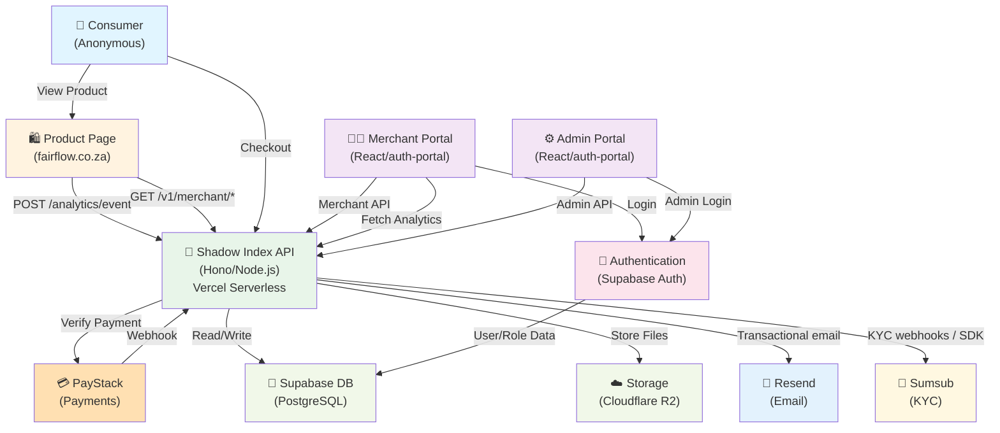
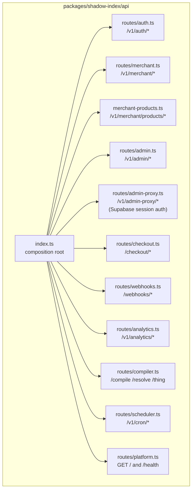
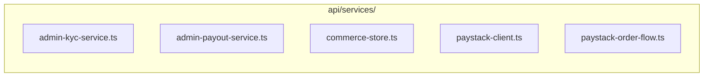
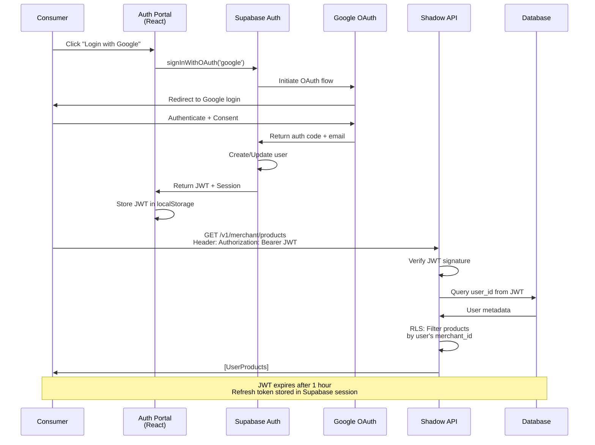
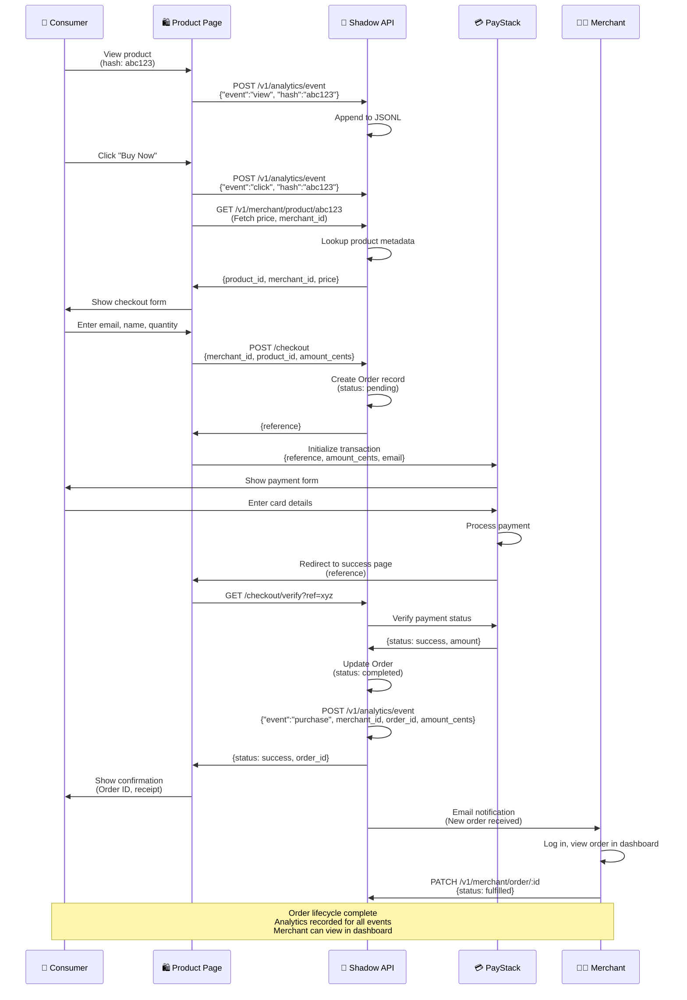
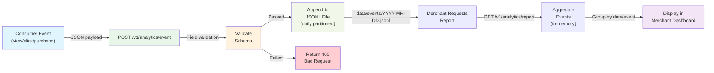
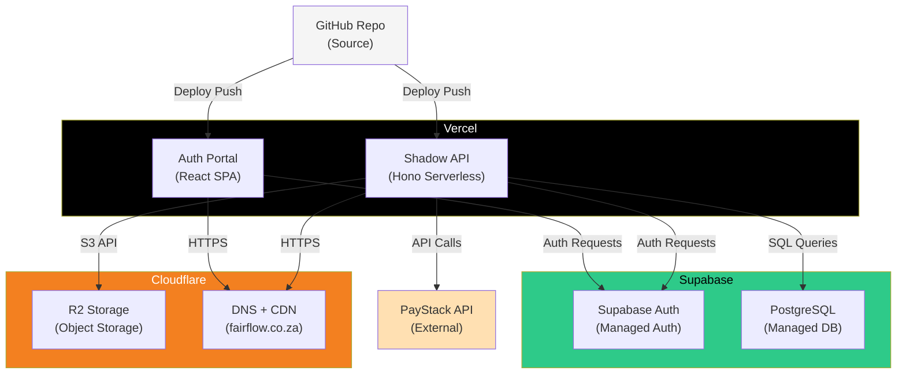

# System Diagrams

UML and system architecture diagrams showing platform topology, authentication flows, and order processing. See [02-TECHNICAL-ARCHITECTURE.md](./02-TECHNICAL-ARCHITECTURE.md) for narrative description.

---

## Platform Architecture

High-level view of all system components and data flows.



**API structure:** Cross-cutting layers live under `packages/shadow-index/api/middleware/` and `api/shared/`; route handlers are composed from `api/index.ts` (see `docs/adr/ADR-001-api-framework.md`).

### Shadow Index API route modules (composition root)



### Services layer (selected)



**Components:**

| Component | Technology | Purpose |
|-----------|-----------|---------|
| **Consumer Shop** | Static/Vite SPA | Public-facing product browsing |
| **Merchant Portal** | React/Vite + Supabase | Merchant dashboard (login, products, analytics, KYC) |
| **Admin Portal** | React/Vite + Supabase | Admin panel (user management, platform metrics) |
| **Shadow Index API** | Node.js/Hono on Vercel | Business logic: auth, products, orders, payments, analytics |
| **Supabase Auth** | PostgreSQL + Row-Level Security | User authentication (email/password, Google OAuth) |
| **PostgreSQL Database** | RLS Policies | Merchants, products, orders, KYC, payouts, events |
| **Cloudflare R2** | S3-compatible Object Storage | Product catalogs (CSV), compiled .thing files, exports |
| **PayStack** | Payment Gateway | Credit card processing, webhook notifications |
| **Resend** | Email API | Order and KYC notifications from shadow-index |
| **Sumsub** | Identity verification | KYC applicant flow and webhooks |

---

## Authentication Flow (OAuth + JWT)

Sequence diagram for user authentication via Google OAuth and JWT session management.



**Key Points:**

- **Google OAuth:** Merchants and admins authenticate via Google; single sign-on
- **JWT Tokens:** Short-lived (1 hour), verified on every API request
- **Row-Level Security:** PostgreSQL RLS policies ensure merchants only see their own data
- **Session Management:** Supabase handles token refresh automatically via session management

---

## Merchant Order Flow

End-to-end flow: Product view → Checkout → Payment → Fulfillment.



**Event Timeline:**

| Step | Event | Recorded? |
|------|-------|-----------|
| 1 | Consumer views product | ✅ view event |
| 2 | Consumer clicks Buy Now | ✅ click event |
| 3 | Order created (pending) | — |
| 4 | Payment initiation | — |
| 5 | Payment success | ✅ purchase event (includes merchant_id, order_id, amount) |
| 6 | Order marked fulfilled | — |

**Data Models Created:**

```
Order:
  - id (UUID)
  - merchant_id (FK)
  - product_id (FK)
  - customer_email
  - amount_cents
  - currency
  - status (pending → completed → fulfilled)
  - paystack_reference
  - created_at
  - updated_at

AnalyticsEvent:
  - event (view|click|purchase)
  - hash (product identifier)
  - anon_id (consumer session)
  - merchant_id (on purchase only)
  - order_id (on purchase only)
  - amount_cents (on purchase only)
  - timestamp
```

---

## KYC (Know Your Customer) Flow

Merchant account verification for payout eligibility.

```mermaid
graph LR
    MerchantSignup["Merchant Signs Up"]
    PortalDashboard["Merchant Portal<br/>Dashboard"]
    KYC_Form["Complete KYC Form<br/>(ID, Tax #, Bank)"]
    Submit["Submit for Review"]
    AdminReview["Admin Review<br/>Documents"]
    Approved["Approved/<br/>Rejected"]
    Payouts["Enabled for<br/>Payouts"]
    Failed["Resubmit or<br/>Account Closed"]
    
    MerchantSignup -->|OAuth Login| PortalDashboard
    PortalDashboard -->|Status: Pending KYC| KYC_Form
    KYC_Form -->|Fields: ID, Tax, Bank, Account| Submit
    Submit -->|POST /v1/merchant/kyc| AdminReview
    AdminReview -->|Verify documents| Approved
    Approved -->|Status: Approved| Payouts
    Approved -->|Status: Rejected| Failed
    Failed -->|Update form fields| KYC_Form
    
    style MerchantSignup fill:#e1f5ff
    style PortalDashboard fill:#f3e5f5
    style KYC_Form fill:#fff3e0
    style AdminReview fill:#f1f8e9
    style Approved fill:#c8e6c9
    style Payouts fill:#c8e6c9
    style Failed fill:#ffcdd2
```



**KYC Fields:**

```json
{
  "id_type": "national_id|passport|drivers_license",
  "id_number": "string",
  "id_expiry_date": "2028-12-31",
  "tax_number": "string (SARS TAX ID)",
  "bank_account_number": "string",
  "bank_account_holder": "string",
  "bank_code": "string",
  "business_registration": "optional",
  "status": "pending|approved|rejected",
  "rejection_reason": "optional",
  "submitted_at": "2026-03-19T12:00:00Z",
  "reviewed_at": "optional"
}
```

---

## Analytics Data Pipeline

How events flow from ingestion to merchant dashboard.



**Key Characteristics:**

- **Write-once:** Events only appended, never updated
- **Daily partitioning:** Immutable daily JSONL files
- **Stateless aggregation:** Reports computed on-demand from raw events
- **No indexes:** Suitable for < 1M events/day; scale to database for larger volume

---

## Data at Rest - Storage Layout

```
fairflow/
├── data/
│   ├── events/
│   │   ├── 2026-03-19.jsonl         (latest events)
│   │   ├── 2026-03-18.jsonl
│   │   └── ...
│   ├── merchants.json               (merchant metadata)
│   ├── products.json                (product catalog)
│   ├── orders.json                  (order records)
│   ├── kyc_records.json             (KYC submissions)
│   └── payout_logs.json             (admin audit trail)
│
├── data/uploads/
│   ├── catalogs/
│   │   ├── merchant-uuid-1.csv      (uploaded product catalogs)
│   │   └── ...
│   └── kyc_docs/                    (KYC document uploads - binary)
│
├── compiled/
│   ├── product-hash-abc123.thing.bin (compiled .thing binaries)
│   └── ...
```

**Storage Backends:**

- **Local Development:** `data/` directory (file system)
- **Production:** Cloudflare R2 (S3-compatible object storage)

---

## Deployment Architecture

How the system is deployed across cloud providers.



**Deployment Characteristics:**

- **Vercel:** Auto-deploys on `git push` to main
- **Supabase:** Hosted PostgreSQL + managed authentication
- **Cloudflare R2:** S3-compatible object storage, automatic failover
- **PayStack:** Third-party payment processor (webhook callbacks)

---

## See Also

- [02-TECHNICAL-ARCHITECTURE.md](./02-TECHNICAL-ARCHITECTURE.md) — Detailed narrative description
- [03-PRODUCT-REQUIREMENTS-DOCUMENT.md](./03-PRODUCT-REQUIREMENTS-DOCUMENT.md) — Feature specifications
- [20-SECURITY-HARDENING.md](./20-SECURITY-HARDENING.md) — Security architecture and data protection

---

## Component Diagram

- matter-core: Rust compiler
- shadow-index: Node.js/Hono API (`api/index.ts` composes `routes/*` and `middleware/*`)
- auth-portal: React/Vite
- lens-extension: Chrome MV3
