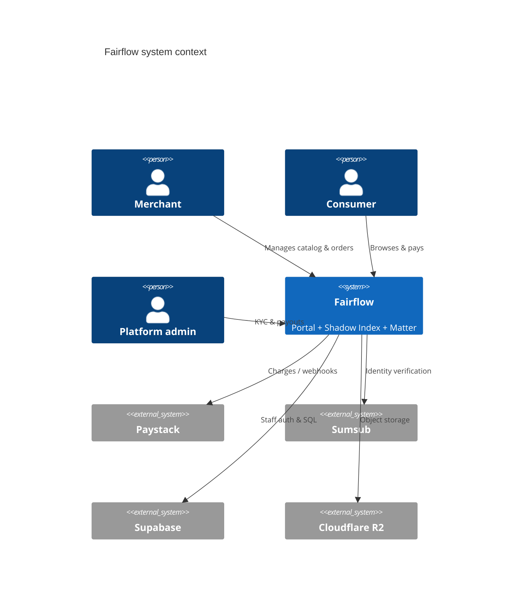
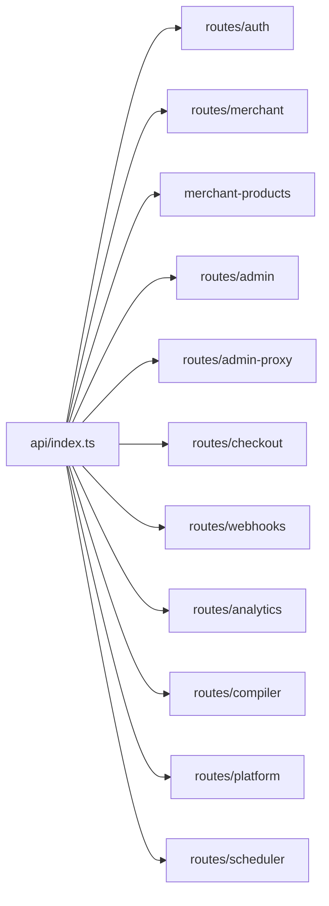
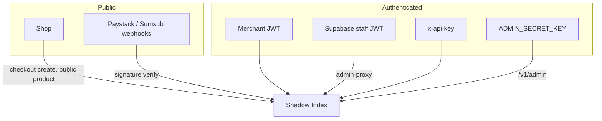
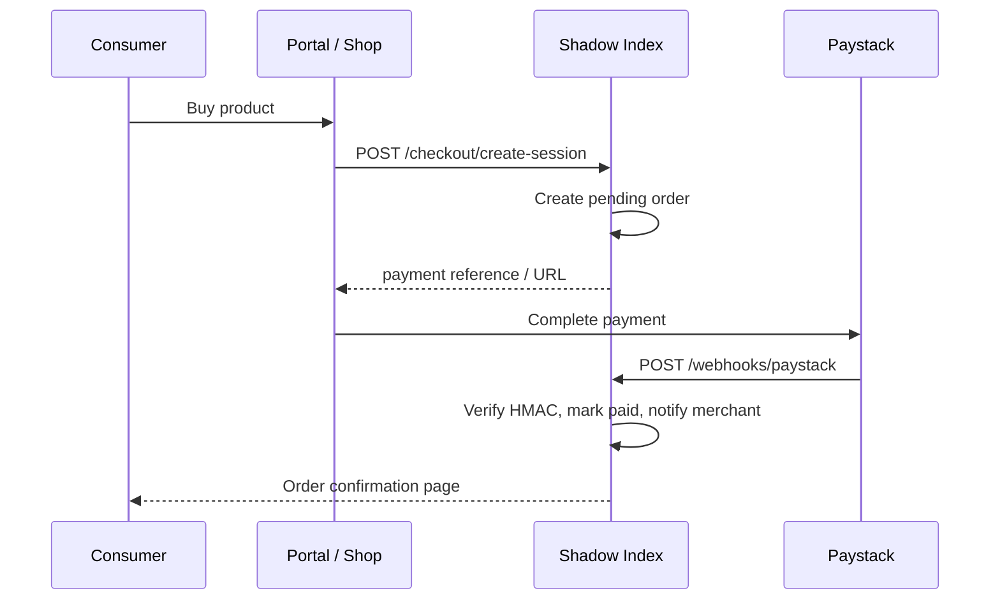

# Architecture

Fairflow is a monorepo commerce platform: a TypeScript API, a React portal, a Rust product compiler, and an optional browser extension.

For numbered historical docs see [02-TECHNICAL-ARCHITECTURE.md](./02-TECHNICAL-ARCHITECTURE.md) and diagrams in [07-SYSTEM-DIAGRAMS.md](./07-SYSTEM-DIAGRAMS.md).

---

## Goals

1. **Merchant-first operations** — catalog, orders, KYC, payouts in one place  
2. **Portable products** — content-addressed `.thing` artifacts beyond a single storefront  
3. **Clear trust boundaries** — merchants, staff, consumers, and webhooks authenticate differently  
4. **Deployable units** — API and SPA ship independently (Vercel)  
5. **Local DX** — file-backed storage and env-driven config without cloud accounts for basic runs  

---

## System context

---

## Package responsibilities

| Package | Role | Runtime |
|---------|------|---------|
| `shadow-index` | Commerce API, resolution, webhooks, analytics | Node.js / Hono |
| `auth-portal` | Merchant, admin, CEO, consumer UI | React / Vite |
| `matter-core` | Compile & sign `.thing` artifacts | Rust |
| `lens-extension` | Resolve hashes in the browser | Chrome MV3 |
| `matter-ffi` | Native bindings (experimental) | Rust/FFI |

### Composition root (API)

`packages/shadow-index/api/index.ts` mounts domain routers:

Cross-cutting concerns live in `api/middleware/` (API key, admin auth, rate limits, CORS) and `api/shared/` (JWT, runtime config, types).

---

## Design decisions

### Why Hono (not Express / Next API routes)?

- First-class TypeScript and middleware composition  
- Excellent fit for Vercel Node serverless cold starts  
- Keeps SPA and API as separate deployables (clear scaling and secret scopes)  

Recorded in [adr/ADR-001-api-framework.md](./adr/ADR-001-api-framework.md).

### Why PostgreSQL + Supabase?

- Staff RBAC with JWT claims and SQL RLS  
- Managed auth for CEO/CTO without building a full IdP  
- Merchants can still use **custom JWTs** from shadow-index (see ADR-005)  

[adr/ADR-003-database.md](./adr/ADR-003-database.md)

### Why Paystack?

- Primary payment network for the SA/merchant target market  
- Webhook verification via HMAC-SHA512  

[adr/ADR-002-payment-provider.md](./adr/ADR-002-payment-provider.md)

### Why dual storage (JSON local + R2 prod)?

- Contributors can run core flows without Cloudflare  
- Production uses durable object storage for `.thing` binaries and uploads  

### Why not Spring Boot?

Fairflow’s team and deploy target are TypeScript/Node and Vercel serverless. Spring Boot would add JVM ops cost without benefit for this latency/deploy profile. The **architectural patterns** (layered routes, services, repos, ADRs) are what matter for portfolio review—not the JVM brand.

---

## Trust boundaries

Rules of thumb:

- **Never** put `ADMIN_SECRET_KEY` or service role keys in the browser  
- Staff mutations go through `/v1/admin-proxy/*` with Supabase session verification  
- Webhooks reject invalid signatures (except explicit local test flags that must stay off in prod)  

---

## Data flow — checkout (simplified)

---

## Scalability notes

| Concern | Current approach | Next step |
|---------|------------------|-----------|
| API compute | Vercel serverless | Keep handlers stateless; externalize session/store |
| Catalog / artifacts | Local JSON or R2 | R2-first + CDN for public assets |
| Analytics | Append-only JSONL + on-read aggregate | Pre-aggregation job (already scaffolded) + DB for high volume |
| Auth | Stateless JWT | Short TTL + refresh; rotate `JWT_SECRET` |
| Rate limits | In-memory / middleware | Shared store (Redis) for multi-instance |

---

## Related documents

- [SYSTEM_DESIGN.md](./SYSTEM_DESIGN.md)  
- [DATABASE.md](./DATABASE.md)  
- [AUTHENTICATION.md](./AUTHENTICATION.md)  
- [DEPLOYMENT.md](./DEPLOYMENT.md)  
- [07-SYSTEM-DIAGRAMS.md](./07-SYSTEM-DIAGRAMS.md)  
