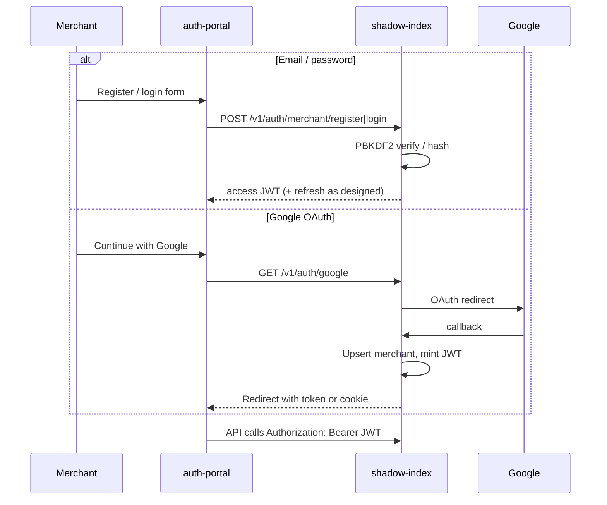
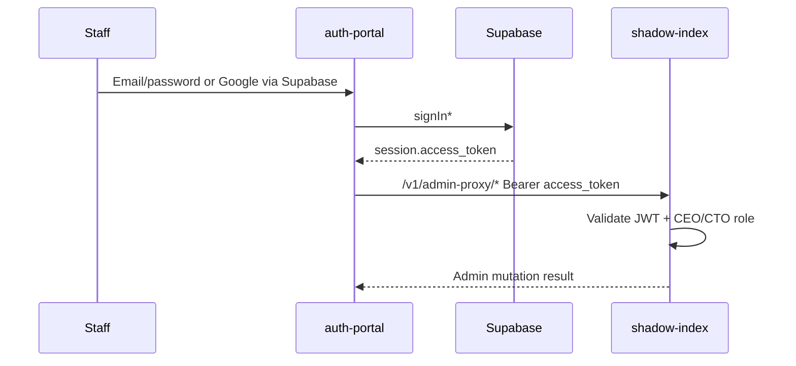

# Authentication

Fairflow uses **multiple auth mechanisms** on purpose: merchants, staff, machines, and payment providers have different threat models.

---

## Actors

| Actor | Primary auth | Issued by |
|-------|--------------|-----------|
| Merchant | JWT (HS256) after password or Google OAuth | shadow-index |
| Staff (CEO/CTO) | Supabase session JWT | Supabase Auth |
| Automation / internal | `x-api-key` | Config (`SHADOW_INDEX_API_KEY`) |
| Admin scripts | `Authorization: Bearer <ADMIN_SECRET_KEY>` | Config |
| Paystack | HMAC-SHA512 header | Paystack + shared secret |
| Sumsub | Webhook secret / signature | Sumsub config |

---

## Merchant auth flow



### Password storage

- Algorithm: **PBKDF2** with **SHA-256**, high iteration count, random salt  
- Format stored as salt:hash (see merchant auth implementation)  
- Plaintext passwords never logged  

### JWT

- Signed with `JWT_SECRET` (required in production)  
- Dev fallback exists only when `NODE_ENV !== 'production'` — never rely on it outside local machines  
- Portal stores merchant token via dedicated storage helper (`merchantTokenStorage`)  

---

## Staff auth flow



**Critical:** the browser must **not** hold `ADMIN_SECRET_KEY`. The admin-proxy pattern keeps the admin secret server-side only.

### Elevated portal role

Staff elevation in the UI is driven by:

1. Supabase JWT claims / `user_roles`  
2. Optional `VITE_ADMIN_EMAILS` (comma-separated) for bootstrap — **configure in env**, do not hardcode personal emails in source  

---

## API key auth

```http
x-api-key: <SHADOW_INDEX_API_KEY>
```

Optional multi-key and revocation lists:

- `SHADOW_INDEX_API_KEYS`  
- `SHADOW_INDEX_REVOKED_KEYS`  

Used for service-to-service and some public/ingest paths per middleware allowlists.

---

## Webhook auth

### Paystack

```http
x-paystack-signature: <hmac_sha512 hex>
```

Computed over raw body with `PAYSTACK_SECRET_KEY`. Invalid signatures → `401/403`.

### Sumsub

Configured via `SUMSUB_WEBHOOK_SECRET`.  
`SUMSUB_SKIP_SIGNATURE_VERIFY` is **local testing only** — must be unset in production.

---

## Google OAuth configuration

| Variable | Purpose |
|----------|---------|
| `GOOGLE_CLIENT_ID` | OAuth client |
| `GOOGLE_CLIENT_SECRET` | Server secret |
| `GOOGLE_REDIRECT_URI` | Must match Google console |
| `AUTH_PORTAL_BASE_URL` | Post-login return base |
| `OAUTH_ALLOWED_RETURN_ORIGINS` | Hardening return_to |
| `GOOGLE_OAUTH_MODE=dev` | Local bypass (dev only) |

---

## Threat notes

| Threat | Control |
|--------|---------|
| Stolen merchant JWT | Short TTL, HTTPS only, rotate `JWT_SECRET` |
| Admin secret in frontend bundle | admin-proxy; secret only on server |
| CSRF on cookie OAuth | Prefer strict cookie flags + origin allowlist |
| Webhook forgery | HMAC verification |
| Credential stuffing | Rate limits; strong passwords; OAuth option |
| Open redirect on OAuth | `OAUTH_ALLOWED_RETURN_ORIGINS` |

---

## Related

- [adr/ADR-005-merchant-auth.md](./adr/ADR-005-merchant-auth.md)  
- [SECURITY.md](./SECURITY.md)  
- `packages/shadow-index/api/routes/auth.ts`  
- `packages/shadow-index/api/routes/admin-proxy.ts`  
