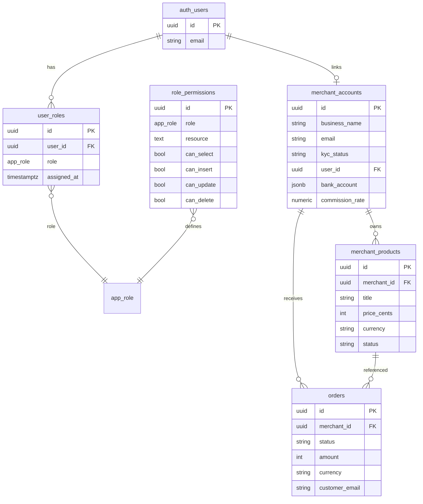

# Database Design

Fairflow uses **Supabase PostgreSQL** for authoritative relational data (auth roles, products, merchant KYC columns) and **file/JSON or R2** for local-dev commerce stores and compiled artifacts.

Migrations live in `supabase/migrations/`.

---

## ER overview



> Exact column sets evolve across migrations `001`–`009`. Treat SQL files as source of truth.

---

## Tables (core)

### `user_roles`

Maps `auth.users` → `app_role` (`ceo`, `cto`, `merchant`, `investor`, `consumer`).

- **PK:** `id`  
- **Unique:** `(user_id, role)`  
- **Index:** `idx_user_roles_user_id`  
- **RLS:** users read own row; CEO/CTO read all; CEO mutates  

### `role_permissions`

Fine-grained resource permissions per role (`products`, `financials`, `users`, …).

### `merchant_accounts`

Merchant profile, KYC status, payout settings, optional OAuth `user_id`.

KYC-related columns added in migrations `005` / `007` (Sumsub reuses some legacy Smile ID column names — see migration comments).

### `merchant_products` / products

Product catalog fields (title, price, currency, status, stock, category). See `004_products_table.sql`.

---

## Local / file-backed stores (dev)

Under `packages/shadow-index/data/` (runtime; some demo fixtures are committed **anonymized**):

| File / dir | Purpose |
|------------|---------|
| `merchant_accounts.json` | Dev merchant records |
| `notifications.json` | In-app notifications |
| `merchant-products.json` | Catalog fallback |
| `things/` | Compiled `.thing` artifacts |
| `events/*.jsonl` | Analytics (gitignored) |
| `orders.json` | Orders (gitignored) |

**Never commit** real PII, live bank details, or production dumps.

---

## Indexes and constraints

| Object | Purpose |
|--------|---------|
| `UNIQUE (user_id, role)` | One assignment row per role pair |
| `idx_user_roles_user_id` | Session role lookup |
| Email uniqueness on merchants | Migration `009` |
| FK `user_id → auth.users` | Cascade delete with auth user |

---

## Migrations

| File | Intent |
|------|--------|
| `001_auth_rbac_schema.sql` | Roles, permissions, authorize() helper, RLS |
| `002_assign_initial_roles.sql` | Bootstrap CEO/CTO (**use placeholder emails in public clones**) |
| `003_rls_policies_example.sql` | Example RLS patterns |
| `004_products_table.sql` | Products |
| `005_merchant_smile_kyc.sql` | KYC columns (legacy name) |
| `007_kyc_sumsub.sql` | Sumsub semantics on existing columns |
| `008_merchant_accounts_oauth_user_id.sql` | OAuth user link |
| `009_merchant_accounts_email_uniqueness.sql` | Email uniqueness |

Apply via Supabase CLI or SQL editor in non-prod first.

```bash
# Example with Supabase CLI (if linked)
supabase db push
```

---

## Authorization helper

`public.authorize(permission, role)` parses `resource.action` (e.g. `products.select`) for RLS policies. See migration `001`.

---

## Backup and retention

- Production: rely on Supabase PITR/backups per plan  
- Analytics JSONL: retention helpers in shadow-index (`lib/retention-policy.ts`)  
- Object storage: R2 lifecycle rules recommended for temp uploads  

---

## Related

- [AUTHENTICATION.md](./AUTHENTICATION.md)  
- [ARCHITECTURE.md](./ARCHITECTURE.md)  
- SQL: `supabase/migrations/`  
