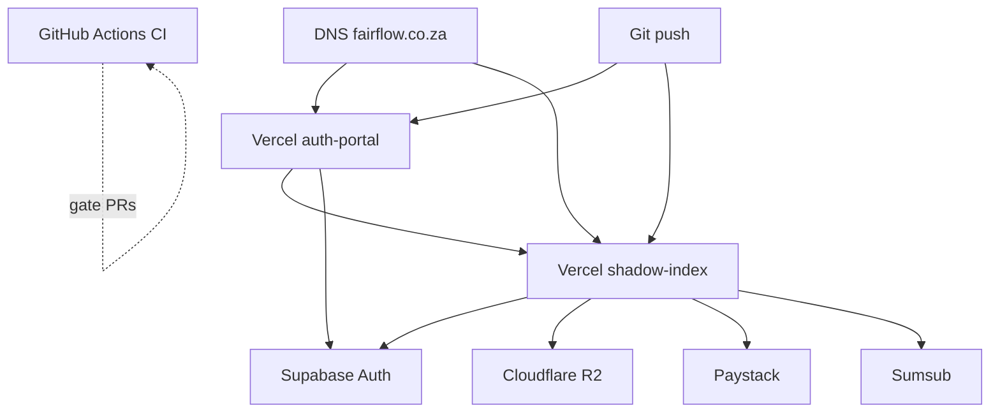

# Deployment

Fairflow deploys as **two Vercel projects** (API + portal) with managed Supabase and optional Cloudflare R2.

Also see root [DEPLOY.md](../DEPLOY.md) for a step-by-step Vercel UI walkthrough and [DEPLOYMENT-CHECKLIST.md](./DEPLOYMENT-CHECKLIST.md).

---

## Architecture (production)



---

## Prerequisites

1. GitHub repository connected to Vercel  
2. Supabase project with migrations applied  
3. Paystack account (test → live keys)  
4. Google Cloud OAuth credentials  
5. Optional: R2 bucket, Sumsub, Resend  

---

## Environment variables

**Never commit real values.** Set them in Vercel → Project → Settings → Environment Variables.

### shadow-index (API)

| Variable | Required | Notes |
|----------|----------|-------|
| `JWT_SECRET` | yes (prod) | Long random secret |
| `ADMIN_SECRET_KEY` | yes | Server only |
| `SHADOW_INDEX_API_KEY` | yes | Match portal `VITE_API_KEY` |
| `PAYSTACK_SECRET_KEY` | yes | `sk_live_` / `sk_test_` |
| `PAYSTACK_PUBLIC_KEY` | yes | |
| `PAYSTACK_CALLBACK_URL` | yes | Portal confirmation URL |
| `SUPABASE_URL` | yes for admin-proxy | |
| `SUPABASE_SERVICE_KEY` | yes for admin-proxy | **service_role — server only** |
| `GOOGLE_CLIENT_ID` / `SECRET` | for OAuth | |
| `GOOGLE_REDIRECT_URI` | yes if OAuth | |
| `AUTH_PORTAL_BASE_URL` | yes (prod) | |
| `PUBLIC_API_BASE_URL` | yes (prod) | |
| `STORAGE_MODE` | `r2` recommended prod | |
| `R2_*` | if `r2` | |
| `SUMSUB_*` | if KYC | |

### auth-portal

| Variable | Required |
|----------|----------|
| `VITE_SUPABASE_URL` | yes (staff login) |
| `VITE_SUPABASE_ANON_KEY` | yes (anon only — not service role) |
| `VITE_API_BASE_URL` | yes |
| `VITE_API_KEY` | yes |
| `VITE_ADMIN_EMAILS` | optional bootstrap |

Full templates: package `.env.example` files and root `.env.example`.

---

## Vercel project settings

### API (`packages/shadow-index`)

- **Root Directory:** `packages/shadow-index`  
- **Entry:** `api/vercel-entry.ts` via `vercel.json`  
- Build: `npm run build` as configured in project  

### Portal (`packages/auth-portal`)

- **Root Directory:** `packages/auth-portal`  
- Framework: Vite  
- Output: `dist`  

> Older docs mentioning `mcj/packages/...` refer to a legacy monorepo layout. Prefer `packages/...` in this tree.

---

## Docker (local / self-host experiment)

```bash
docker compose up --build
```

Services:

| Service | Port | Image context |
|---------|------|----------------|
| `api` | 3000 | `packages/shadow-index` |
| `portal` | 5178 | `packages/auth-portal` |

Compose reads env from `packages/*/.env` when present. **Do not** bake secrets into images.

### Production container notes

- Prefer managed serverless for the reference architecture  
- If self-hosting: run Node 20, set `NODE_ENV=production`, terminate TLS at a reverse proxy, mount durable storage for `data/` or use R2  
- Do not enable `SUMSUB_SKIP_SIGNATURE_VERIFY` or `GOOGLE_OAUTH_MODE=dev`  

---

## Post-deploy verification

```bash
curl -fsS "$PUBLIC_API_BASE_URL/health"
# Portal loads, login pages render
# Test Paystack webhook with provider tools
# Confirm admin-proxy rejects unauthenticated calls
```

Optional: `packages/shadow-index` → `npm run smoke:prod`

CI workflow: `.github/workflows/ci.yml`  
Post-deploy smoke: `.github/workflows/post-deploy-smoke.yml`

---

## Rollback

1. Vercel → Deployments → Promote previous production deployment  
2. If migration caused failure: restore DB from backup; avoid down-migrations without a plan  
3. Rotate secrets if a bad deploy leaked env via logs  

---

## Related

- [OPERATIONS-RUNBOOK.md](./OPERATIONS-RUNBOOK.md)  
- [VERCEL-UPTIME-RUNBOOK.md](./VERCEL-UPTIME-RUNBOOK.md)  
- [adr/ADR-004-deployment.md](./adr/ADR-004-deployment.md)  
