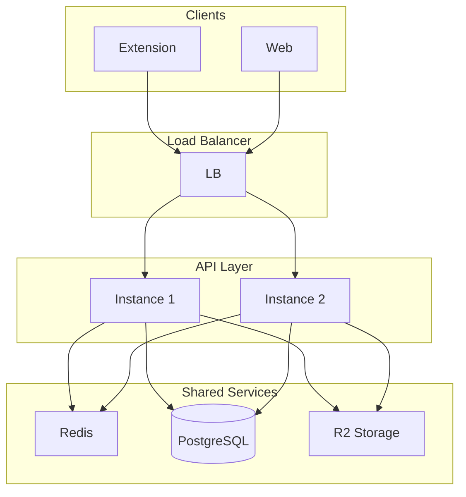

# Distributed Deployment Architecture

**Sprint 4 Week 4**  
**Date:** February 10, 2026  
**Phase:** Planning (Implementation Phase 5–6, Q2–Q3 2026)

---

## 1. Current Architecture (Single Node)

```
[Client] → [Shadow Index API] → [Local FS / R2]
                   │
                   ├── Query Cache (in-memory)
                   ├── Pre-aggregates (local)
                   └── Analytics events (JSONL)
```

---

## 2. Multi-Instance Deployment

### Target Topology

```
                    [Load Balancer]
                           │
         ┌─────────────────┼─────────────────┐
         ▼                 ▼                 ▼
   [Instance 1]     [Instance 2]     [Instance 3]
         │                 │                 │
         └─────────────────┼─────────────────┘
                           │
         ┌─────────────────┼─────────────────┐
         ▼                 ▼                 ▼
   [Redis Cache]    [PostgreSQL]    [R2 Storage]
```

### Components

| Component | Role |
|-----------|------|
| Load balancer | Distribute traffic; health checks |
| API instances | Stateless; horizontal scaling |
| Redis | Shared query cache (replace in-memory) |
| PostgreSQL | Events, aggregates (replace JSONL) |
| R2 | Thing files (unchanged) |

---

## 3. Cache Consistency

**Strategy:** Eventual consistency.

- **Query cache:** TTL-based (1h). Cache invalidation on event ingestion broadcasts to all instances via Redis pub/sub or cache key expiry.
- **Pre-aggregates:** Computed by cron on one node; written to shared DB. All nodes read same data.
- **Rate limit:** Redis-backed counters (replace in-memory Map) for accurate per-IP limits across instances.

---

## 4. Event Stream Partitioning

- **Option A:** Single PostgreSQL; all instances write to same DB.
- **Option B:** Partition by tenant/hash prefix for very high volumes.
- **Recommendation:** Start with Option A; partition only if necessary.

---

## 5. Implementation Timeline

| Phase | Scope | Timeline |
|-------|-------|----------|
| Phase 5 | SQLite migration; Redis cache option | Q2 2026 |
| Phase 6 | PostgreSQL; multi-instance deployment | Q2–Q3 2026 |

---

## 6. Architecture Diagram (Mermaid)



---

*Document: DISTRIBUTED-DEPLOYMENT-ARCHITECTURE.md. Sprint 4 Week 4.*
