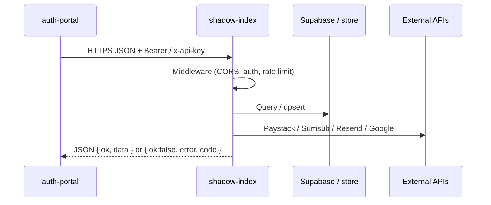
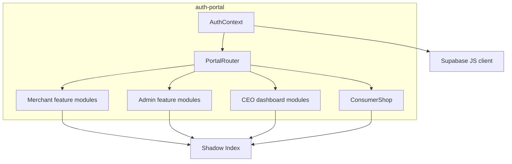
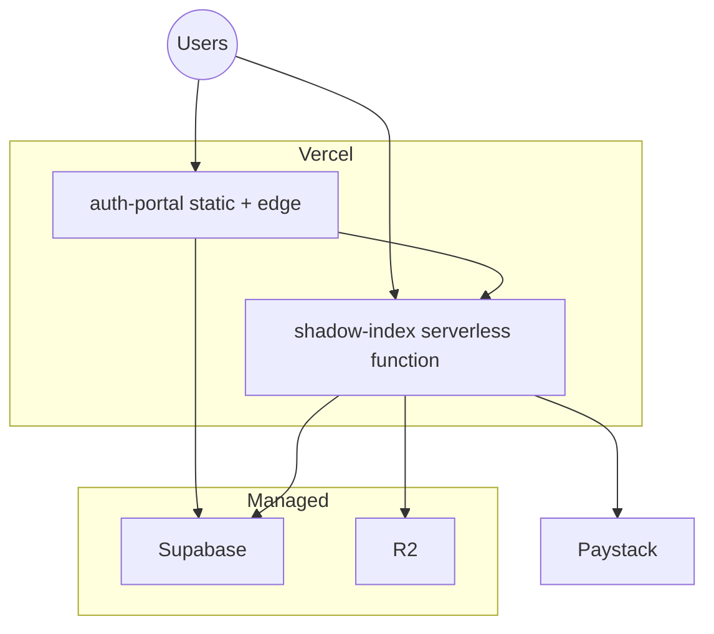

# System Design

This document describes component boundaries, communication patterns, and consistency choices for Fairflow.

---

## Logical components

| Component | Owns | Does not own |
|-----------|------|--------------|
| **auth-portal** | UI state, client routing, presentation | Payment secrets, admin secret, service role key |
| **shadow-index** | Business rules, webhooks, JWT issue/verify, storage adapters | Browser session cookies for Supabase staff (portal does) |
| **Supabase** | Staff users, SQL tables, RLS, optional product rows | Paystack settlement |
| **matter-core** | Compile/sign/hash pipeline | HTTP serving |
| **lens-extension** | Page detection + overlay | Authoritative pricing (always resolve via API) |

---

## API communication

### Conventions

- Prefer versioned paths under `/v1/*` for product APIs  
- Errors: structured JSON with stable `code` where possible  
- Validation: Zod at the HTTP boundary  
- Idempotency: payment/charge paths guard duplicate provider references  

OpenAPI: `packages/shadow-index/openapi.yaml`

---

## Component relationships (portal)

Feature folders under `src/features/*` keep hooks, components, and API clients close to the domain.

---

## Consistency model

| Data | Consistency | Notes |
|------|-------------|-------|
| Orders vs Paystack | Provider is source of truth after webhook | Local order transitions on verified events |
| Merchant JWT sessions | Stateless | Revocation = secret rotation or short TTL + blocklist (future) |
| Analytics events | Append-only | Aggregates may lag; pre-agg jobs optional |
| Product catalog | Per-request read | No distributed cache required at beta scale |

---

## Failure modes

| Failure | User impact | Mitigation |
|---------|-------------|------------|
| Paystack down | Checkout init fails | Clear error; retry; no false “paid” |
| Webhook delayed | Order stays pending | Verify endpoint / reconciliation job |
| Supabase auth down | Staff login fails | Merchants on custom JWT may still operate |
| R2 unavailable | Artifact upload/resolve fails | Health checks; local mode only for dev |
| Sumsub outage | KYC start fails | Status remains `not_started` / retry |

Ops runbook: [OPERATIONS-RUNBOOK.md](./OPERATIONS-RUNBOOK.md)

---

## Security design summary

- Secrets only via environment variables  
- Password hashing: PBKDF2-SHA256, 100k iterations, random salt  
- Webhook HMAC verification  
- Admin secret never shipped to the client (admin-proxy pattern)  
- CORS and rate limiting middleware  
- RLS on Supabase tables for staff/merchant separation  

See [SECURITY.md](./SECURITY.md) and [20-SECURITY-HARDENING.md](./20-SECURITY-HARDENING.md).

---

## Deployment topology

Details: [DEPLOYMENT.md](./DEPLOYMENT.md)
